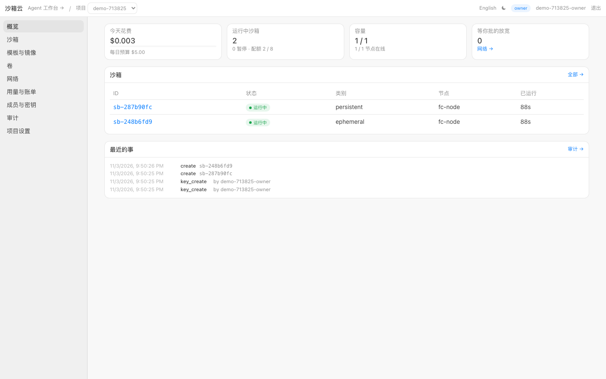
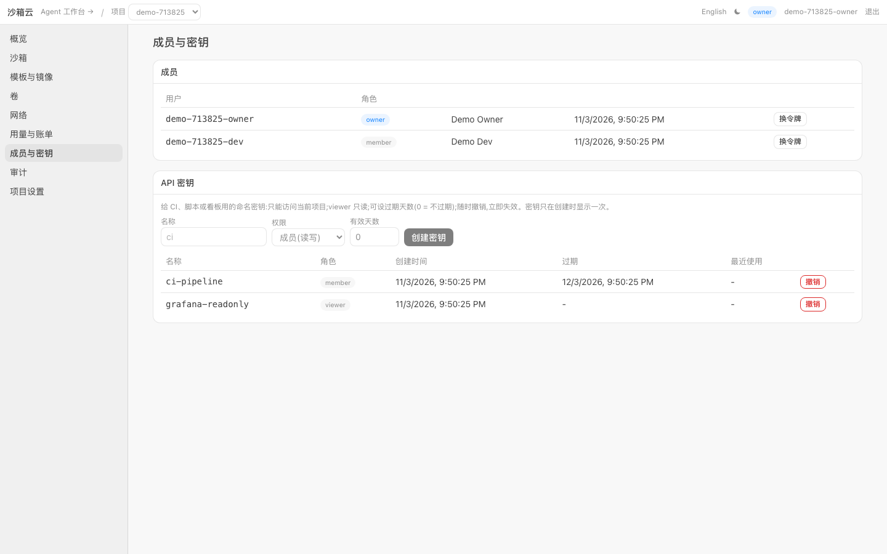
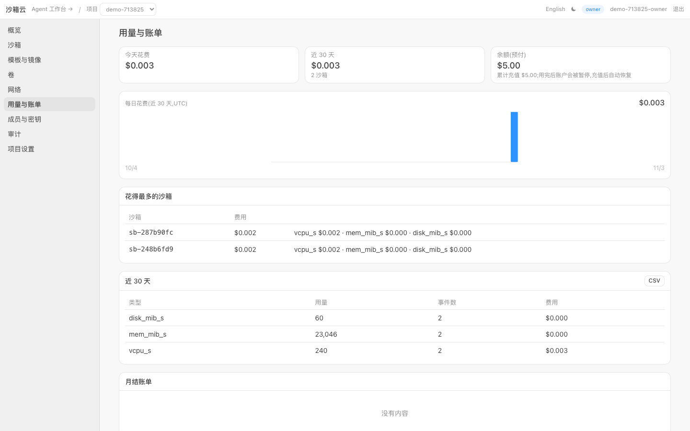
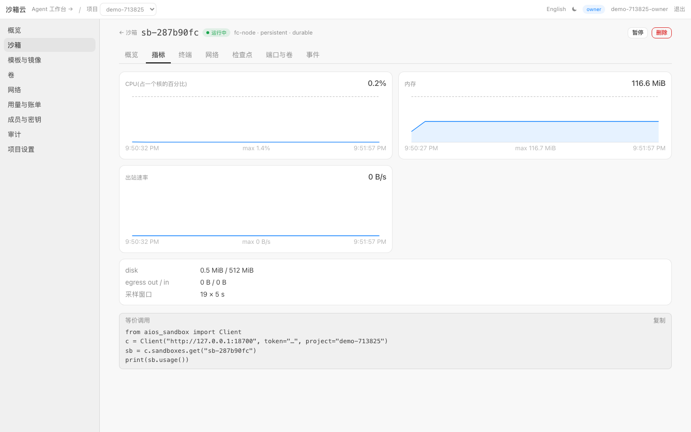
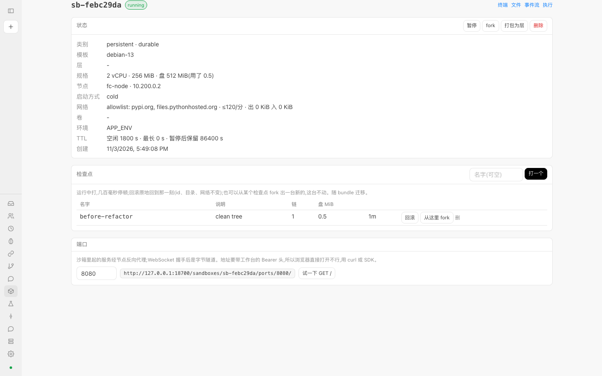
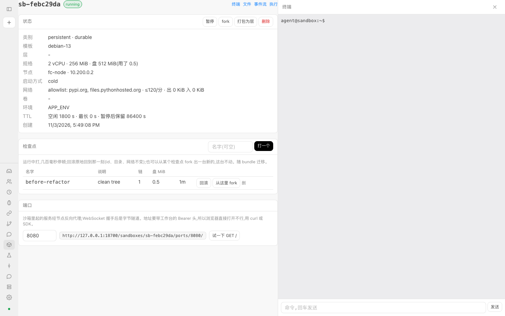
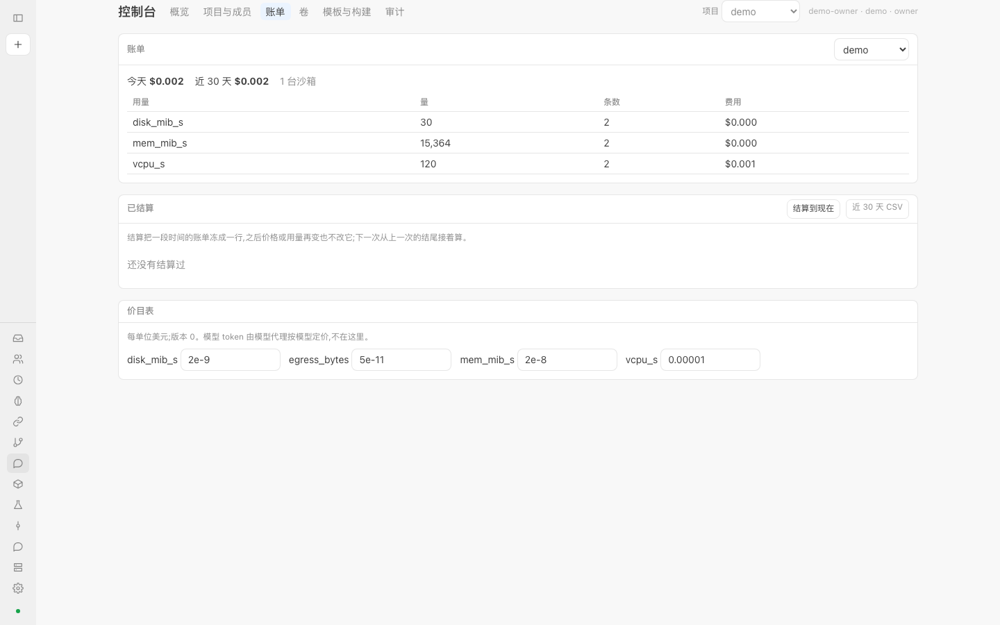
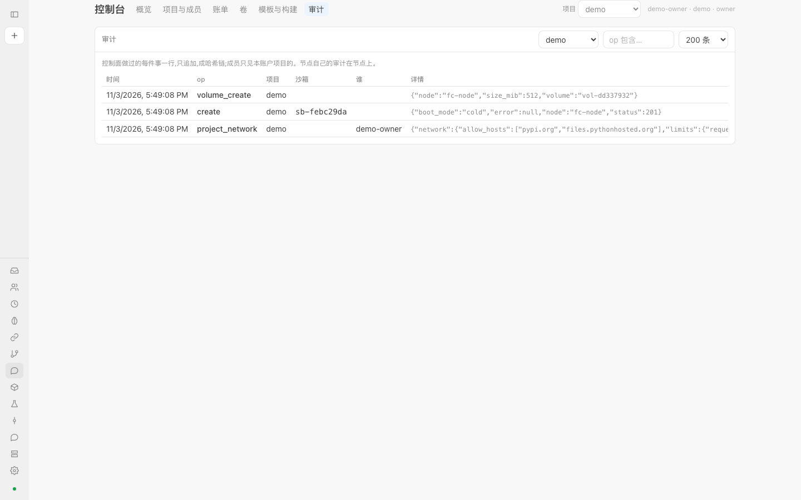
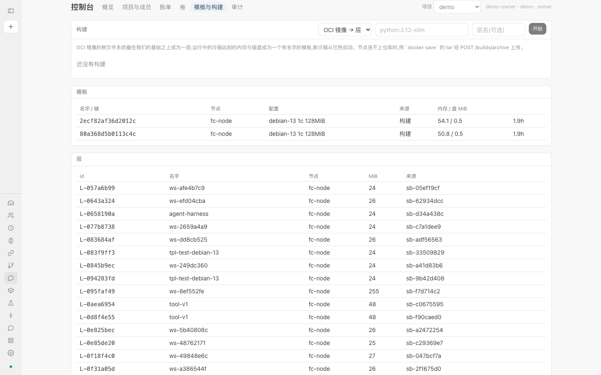
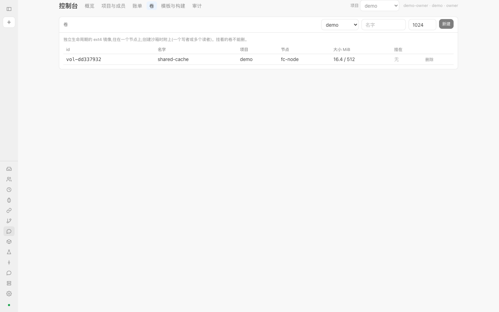

# Cairn 平台

> English overview: [README.en.md](README.en.md) · English docs: [docs/en/](docs/en/README.md)

一个仓库,两层产品:

| 层 | 是什么 | 对标 | 入口 |
| --- | --- | --- | --- |
| **Cairn 沙箱云**(下面这层) | 给 agent 跑代码的 microVM 沙箱云:毫秒级热启、检查点 / 回滚 / fork、迁移、卷、L7 出口策略、多租户、计量账单、控制台 | E2B、CubeSandbox、AgentRun | HTTP(CONTRACT §1)、Python SDK、MCP、E2B 形状的 REST |
| **Cairn agent**(上面那层) | 一个托管的、会变强的个人编码 agent:沙箱知道它在给谁干活(预算、工单、inbox、事件),评测与进化 | Codex / DSH 一类的 agent 工作台 | 工作台、代码托管与聊天工具的接入 |

两层的接缝只有一道(docs/002):agent 层向沙箱云要一台沙箱、写进工单、等报告。外部 agent 只用下面这层。

---

## Cairn 沙箱云

### 一眼看到的

| | |
| --- | --- |
|  |  |
| 控制台概览:本项目沙箱、今天花费、容量、等你批的放宽、最近的事 | 成员与 API 密钥:换令牌;命名密钥(单项目、可只读、可过期、可撤销) |
|  |  |
| 用量与账单:预付余额、每日柱状图、花得最多的沙箱、CSV | 沙箱指标:CPU / 内存 / 出站曲线(节点每 5 秒采样) |
|  |  |
| 一台沙箱:规格、网络与限额、卷、环境、保留期;检查点打 / 回滚 / 从这里 fork;端口 | 右栏终端 / 执行 / 文件 / 事件流 |
|  |  |
| 账单:今天、近 30 天、结算、CSV、价目表 | 审计:控制面做过的每件事,成员只见本账户的;哈希链可核对 |
|  |  |
| 模板与构建:OCI 镜像成层、运行中的沙箱提交为模板、分发矩阵 | 卷:独立生命周期的 ext4,附到沙箱,随迁移走 |

更多:[沙箱列表](docs/screenshots/07-sandboxes.png)、[个人 harness 目录](docs/screenshots/10-home-directory.png)、[agent 对话的空状态](docs/screenshots/12-workbench-chat.png)。截图来自开发机上的真实部署,以 demo 账户 owner 的身份看;节点页只有部署者能看,没截。

### 五分钟

```bash
scripts/bootstrap.sh && cd deploy && docker compose up -d      # 整套:注册表、SQL、分块仓库、节点、控制面、模型代理、评测器、Agent 服务
pip install -e sdk/python
CAIRN_URL=http://127.0.0.1:18700 CAIRN_TOKEN=$(cat deploy/secrets/cp.token) python3 sdk/python/examples/quickstart.py
```

```python
from cairnbox import Client
c = Client("http://127.0.0.1:18700", token="…", project="acme")
with c.sandboxes.create(mem=512, network={"allow_hosts": ["pypi.org"]}) as sb:
    print(sb.commands.run("python3 -V").check().stdout)
    sb.checkpoints.create("clean"); sb.commands.run("rm -rf /home/agent/*"); sb.checkpoints.rollback("clean")
    clone = sb.fork(checkpoint="clean")[0]
```

JS / TS:`sdk/js`(`cairnbox`,零依赖,同样的形状,[参考](docs/guide/sdk-js.md))。

给 agent 当工具:`claude mcp add cairn -- python3 -m cairnbox.mcp`(12 个工具:建、跑、读写文件、检查点 / 回滚 / fork、暂停 / 恢复 / 删)。用 E2B 的 SDK:指向 18710 端口,`Sandbox.create` / list / pause / resume / kill 能用;命令与文件走我们的 SDK(没有 envd,见 D40/D43)。

### 能做什么

| | 有 | 数字(开发机,[bench](docs/research/benchmark-2026-11.md)) |
| --- | --- | --- |
| 沙箱 | Firecracker microVM + jailer;冷启 / 从模板快照热启;空闲自动暂停、透明恢复;TTL 与暂停保留期;ephemeral / persistent 两类,interactive / batch / background 三级优先与抢占 | 冷启 396 ms,热启 **85 ms**,exec 往返 5 ms,16 台不变慢 |
| 时光 | 运行中打检查点、原地回滚(id / 网络不变)、从检查点 fork n 台、运行中提交为模板 | 检查点 47 ms,回滚 238 ms,fork 328 ms |
| 搬家 | 迁移(带检查点与卷)、节点失联后从 bundle 接管、排空、均衡、cordon | |
| 文件系统 | 只读 base + 层(配方 / OCI 镜像 / 运行中打包)+ 可写层;按需加载的分块仓库;独立卷(单写者 / 多读者) | 每台空闲 60–72 MiB(含 guest 页) |
| 网络 | guest 无 DNS、一切经出口代理;closed / allowlist / audited;L7 规则(host 通配 / 正则、path、method)、凭证注入(密钥不进沙箱)、每沙箱限额;放宽要 owner 批准;端口暴露(含 WebSocket 隧道) | |
| 租户 | 账户 ⊃ 项目 ⊃ 成员;配额(并发、存储、每日花费);项目默认网络;令牌轮换与过期;命名 API 密钥(单项目、可只读、可撤销);邀请码自助开户;预付额度;账户停用与滥用检测(只标记);成员只见本账户 | |
| 计量 | CPU 秒、内存 MiB 秒、存储、出站字节、模型 token;价目表版本化;结算账本与 CSV | |
| 运维 | 控制台(Next.js,`/console/`)含实时指标曲线;公开 `/status`;节点自我围栏与可选自动接管;预览域名;控制面 ↔ 节点可选 TLS;分块仓库可落到 S3 兼容存储(Garage);控制面多副本(Redis / Postgres 共享状态,节点是运行态权威);`/metrics`;审计哈希链;compose 一键部署;升级 drain → 换镜像 → uncordon | |
| agent 面(我们独有) | 沙箱内核 ABI:预算、工单、inbox、事件日志、report;harness 目录;评测与进化 | |

和 CubeSandbox 逐项的对照在 [docs/research/cubesandbox-vs-ours.md](docs/research/cubesandbox-vs-ours.md);没做的在 [D47](docs/decisions.md) 之前每条决定的"没做的"里,大的几项:E2B 的 envd 数据面、对象存储后端、专用机器上的密度数、Dockerfile 建模板、外部安全审查([013 威胁模型](docs/013-threat-model.md))。

### 文档

给用的人:[docs/guide/](docs/guide/README.md)——租户手册、API 参考、SDK 与 MCP 参考、教程。想知道离商业化还差什么:[docs/research/commercialization-gap-2026-11.md](docs/research/commercialization-gap-2026-11.md);对外开放前的安全最短清单在 [013 威胁模型](docs/013-threat-model.md) 末尾。

[docs/README.md](docs/README.md) 从 000 读起:000 原则 · 001 一个人的一天 · 002 领域(含沙箱侧八个上下文)· 003 沙箱与平台 · 004 guest · 005 接单 · 006 执行 · 007 评测 · 008 工作台 · 009 安全与数据 · 010 部署 · 011 架构索引 · 012 cookbook · 013 威胁模型;每个决定在 [decisions.md](docs/decisions.md)(D1–D47)。接口合同:[CONTRACT.md](CONTRACT.md)。

---

## Cairn agent

**一个托管的、会变强的个人编码 agent**。你得到一个属于自己的 agent,接进你已经在用的地方(代码托管、聊天工具),在对话里交代一件事,然后走开。它在隔离的沙箱里做事,只在**做完了、卡住了、要你做决定**时找你;不可逆的事(合并、向外发消息、超预算、定例行)只给你一份草稿,你同意才发生。你纠正它一次,它记住,下次不再错;它的运行系统在你自己的任务上被不断评测和改进,每次更新对你是一段话:改了什么、为什么、在你的哪些事上好了、怎么退回。

一个人的一天(详见 [docs/001](docs/001-journey.md)):

1. 登录工作台(`/ui/`),第一屏是一段空的对话。
2. "把登录页空输入时崩溃的问题修一下。"——它回一句"接到了",开始做。
3. 你合上电脑。它做完后在对话里说一句,附 PR;合并是一张草稿卡,卡上带着**独立审查**的结论(改到了 CI 路径?有密钥?删了测试?)。
4. 你看了一眼,说"不对,别动 eval/ 下的东西"——对话里出一句"**记住了**",以后每件事开始时它都带着这条规则,有检查的规则在它交付之前先被检查一遍。
5. "以后每天早上八点,把昨晚的 CI 失败整理给我。"——一条例行的草稿,你点头才生效。
6. 它缺了一个只有你知道的数,问你一句;你答了,它接着做。一件事不该由它做时,它交给你开的另一个 agent。
7. 偶尔一条"更新了":改了什么、为什么、预计与实际、怎么退回。

怎么读代码与文档:[docs/README.md](docs/README.md)(从 000 读起);扩展:[docs/012](docs/012-cookbook.md);在开发机上真实走一遍的脚本:[`ops/`](ops/),说明在 [docs/010](docs/010-deployment.md)。没有部署也想看看工作台:`python3 ops/ui-demo.py` 起一个带种子数据的假服务,再 `CP_URL=http://127.0.0.1:18701 npm --prefix web run dev`。

## 部署与开发

要求:Linux x86_64、`/dev/kvm`、Docker 24+(compose v2)、约 15 GB 磁盘。第一次装要编译 guest 内核,30–60 分钟。

```bash
scripts/bootstrap.sh                 # Firecracker、镜像、内核、guest runtime、基础镜像、密钥、控制台、分块仓库
cd deploy && docker compose up -d
```

`scripts/bootstrap.sh` 本身**还没有从干净机器整条跑过**:干净副本上已分步验证镜像、单元测试、guest runtime、基础镜像和 compose 起栈,SDK 快速上手 13/13 通过(详见 [docs/en/quickstart.md](docs/en/quickstart.md) 末尾);Firecracker 下载、内核编译、控制台构建没有从零跑过。项目之外还没人照着装过,遇到问题请开 issue 写明哪一步、什么错误。
在区域镜像后面构建:导出 `APT_MIRROR`、`PIP_INDEX`、`GOPROXY`、`CARGO_MIRROR`、`KERNEL_URL`(见脚本头部)。

目录:`cp/` 控制面(Go)· `node/` 节点代理(Python)· `guest/` guest 内的 runtime(Rust)· `sdk/` Python 与 JS SDK、CLI、MCP · `console/` 控制台 ·
`deploy/` compose 与运维 · `recipes/` 内核、基础镜像、层的配方 · `aios/` `intake/` `eval/` `web/` agent 层。各部件的细节在 [docs/011](docs/011-architecture.md);
原型阶段的实验手记在 [docs/history/prototype-firecracker.md](docs/history/prototype-firecracker.md)。英文入口:[docs/en/](docs/en/README.md)。

## 状态、路线与参与

单台机器上实测;**没有外部渗透测试**,没有对外基线,多节点未做压力。完整清单见 [ROADMAP.md](ROADMAP.md);安全问题见 [SECURITY.md](SECURITY.md);
参与方式见 [CONTRIBUTING.md](CONTRIBUTING.md)(提交要 `git commit -s`)与 [行为准则](CODE_OF_CONDUCT.md)。

许可证:Apache-2.0([LICENSE](LICENSE)),第三方内容见 [NOTICE](NOTICE)。
