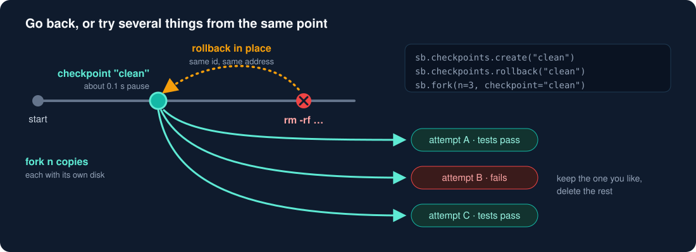
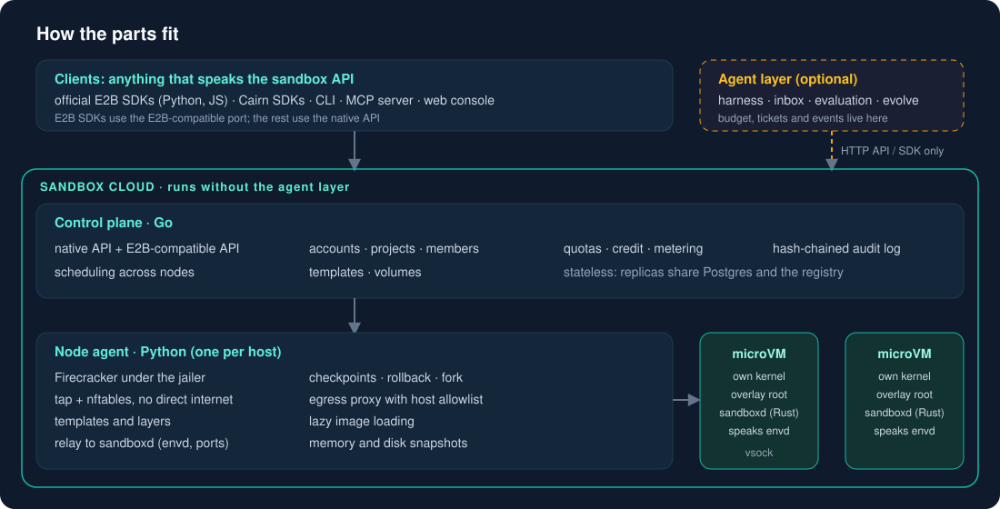
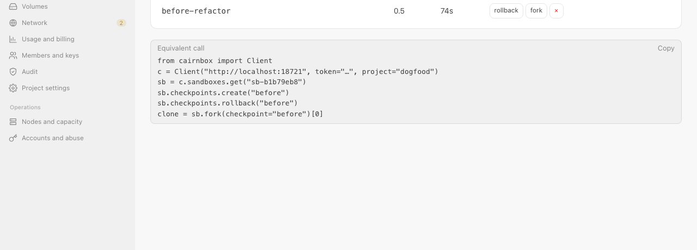
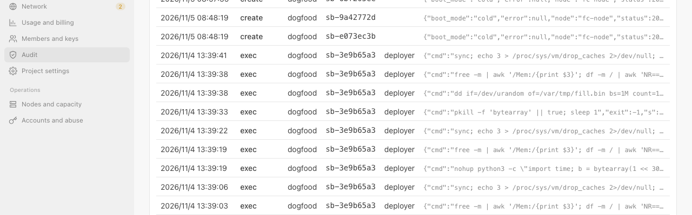

<div align="center">


<br>

[](https://github.com/William2333ZZ/cairn/actions/workflows/ci.yml) [](LICENSE) [-F59E0B)](#状态) [](docs/en/quickstart.md) [](docs/en/architecture.md)

**[English](README.md) · [中文](README.zh.md) · [快速开始](docs/en/quickstart.md) · [功能清单](docs/guide/features.md) · [路线图](ROADMAP.md) · [设计决定](docs/decisions-index.md)**

</div>

agent 写代码、跑命令、装依赖,总会出错,也总有一天会做不该做的事。Cairn 把它放进一台**随时可以倒回去**的虚拟机里:每台沙箱是独立的 microVM,有自己的内核,不和宿主或别的沙箱共用。

| | |
| :-- | :-- |
| ⏪ **倒得回去** | 运行中打检查点(我们的实测里只暂停约 0.1 秒),原地回滚(id 与网络不变),或从任一检查点 fork 出 n 份各试各的。 |
| 🔒 **出不去,除非你批** | 沙箱默认没有直连网络,出站请求经代理、只放行白名单。成员想放宽要所有者批准;密钥在代理处注入,不进沙箱。 |
| 🧾 **查得到** | 控制面做过的每件事(包括每次 `exec` 和文件读写)记进哈希链,可以核对没被改过。 |
| 👥 **知道在为谁干活** | 账户、项目、成员、配额、预付额度与用量账单,都在沙箱这一层。 |

<div align="center">

</div>

## 快速开始

```bash
scripts/bootstrap.sh && cd deploy && docker compose up -d        # 第一次要编译内核,见下面的说明
pip install -e sdk/python
export CAIRN_URL=http://127.0.0.1:18700 CAIRN_TOKEN=$(cat deploy/secrets/cp.token)
python3 sdk/python/examples/quickstart.py
```

```python
from cairnbox import Client

c = Client("http://127.0.0.1:18700", token="…", project="acme")
with c.sandboxes.create(mem=512, network={"allow_hosts": ["pypi.org"]}) as sb:
    print(sb.commands.run("python3 -V").check().stdout)
    sb.checkpoints.create("clean")
    sb.commands.run("rm -rf /home/agent/*")
    sb.checkpoints.rollback("clean")                  # 文件回来了
    clone = sb.fork(checkpoint="clean")[0]            # 从同一点分出一份独立的
```

> [!NOTE]
> 需要 Linux x86_64、`/dev/kvm`、Docker 24+(compose v2)、约 15 GB 磁盘。第一次装要编译 guest 内核,30–60 分钟。
> JS / TS:`sdk/js`(`cairnbox`,零依赖)。给 agent 当工具:`claude mcp add cairn -- python3 -m cairnbox.mcp`。
> 另有一个 E2B 形状的 REST 口(18710 端口):`Sandbox.create` / list / pause / resume / kill 等常用调用能用,**不是完整兼容**,差异见 [docs/guide/sdk.md](docs/guide/sdk.md)。

## 它是怎么搭的

<div align="center">

</div>

底下是 Firecracker microVM(由 jailer 启动),上面是控制面、Python 与 JS SDK、CLI、MCP 和控制台。**agent 层是可选的**:一个托管的个人编码 agent,
沙箱认识它的预算、工单和事件;它只通过 HTTP 或 SDK 要沙箱,不用它,沙箱云照样跑(`tests/unit/test_layers.py` 强制这条边界)。

<div align="center">
<br><sub>一台沙箱的检查点:原地回滚,或从任一检查点 fork 出新沙箱(控制台界面默认英文,可切换中文)</sub>
<br><br>
<br><sub>审计:控制面做过的每件事,哈希链可核对</sub>
</div>

<details>
<summary><b>agent 层是什么</b></summary>

一个托管的、会变强的个人编码 agent:接进你已经在用的地方(代码托管、聊天工具),在对话里交代一件事,然后走开。它只在**做完了、卡住了、要你做决定**时找你;
不可逆的事(合并、向外发消息、超预算、定例行)只给你一份草稿,你同意才发生。你纠正它一次,它记成规则,以后每件事开始时带着,有检查的规则在交付前先被检查一遍。
一个人的一天见 [docs/001](docs/001-journey.md);工作台见 [docs/008](docs/008-workbench.md)。这一层同样是 Apache-2.0,但比沙箱云更早期。

</details>

## 状态

> [!WARNING]
> 单台机器上实测。**没有外部渗透测试**,没有对外基线,多节点未做压力。`scripts/bootstrap.sh` 本身没有从干净机器整条跑过(分步验证见 [docs/en/quickstart.md](docs/en/quickstart.md) 末尾),项目之外还没人照着装过。
> 别把它当作隔离不可信公共租户的唯一屏障。

没做的事都写在 [ROADMAP.md](ROADMAP.md)。安全问题请走 [SECURITY.md](SECURITY.md),不要开公开 issue。

## 读下去

| | |
| :-- | :-- |
| 用的人 | [docs/guide/](docs/guide/README.md):租户手册、API 参考、SDK 与 MCP 参考、教程 · [功能清单](docs/guide/features.md) |
| 读代码的人 | [docs/README.md](docs/README.md)(000 原则 … 013 威胁模型)· [docs/011](docs/011-architecture.md) 各部件索引 · [docs/decisions-index.md](docs/decisions-index.md) 每个决定与理由 |
| 英文读者 | [docs/en/](docs/en/README.md):快速开始、架构、安全模型 |
| 参与 | [CONTRIBUTING.md](CONTRIBUTING.md)(提交要 `git commit -s`)· [行为准则](CODE_OF_CONDUCT.md) |

目录:`cp/` 控制面(Go)· `node/` 节点代理(Python)· `guest/` guest 内的 runtime(Rust)· `sdk/` SDK、CLI、MCP · `console/` 控制台 · `deploy/` compose 与运维 · `recipes/` 内核、基础镜像、层的配方 · `aios/` `intake/` `eval/` `web/` agent 层。

<div align="center"><sub>Apache-2.0 · <a href="LICENSE">LICENSE</a> · 第三方内容见 <a href="NOTICE">NOTICE</a></sub></div>
