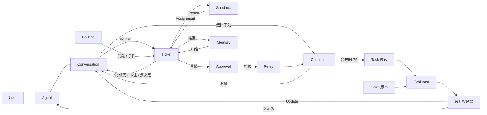
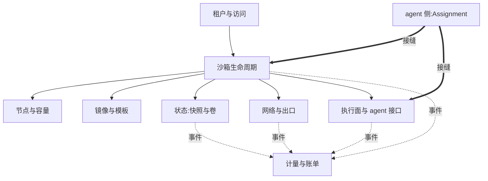

# 002 领域模型

本文定义其余文档使用的概念。它建立在 [000 原则](000-principles.md) 与 [001 用户使用过程](001-journey.md) 之上:001 用用户的词写一个人怎样用这个平台,这里把那些词落成概念,后面的文档只用概念。

一个 **User** 有一个 **Agent**。用户和它之间是一段 **Conversation**;用户在任何 **Connector**(代码托管、聊天工具、工作台)上说的话都进这段对话,agent 对用户说的每句话也从这里出去、送回它来的地方。对话里的一句话经 **Router** 判定:是插话,就作为 **Input** 送进正在做的 **Ticket**;是新的事,就由 Eval 开出带 **Mandate** 的 Ticket。**Assignment** 把 Ticket 交给一台 **Sandbox**,沙箱里跑的是这个 Agent 当前的 **Cairn 版本**;它经 **Report** 自报进展,其中只有做完、卡住、要决定三种会变成对用户说的话;不可逆的动作只能提成 **Approval**,用户同意后由 **Relay** 执行。做完的事进 **Memory**,下一件事从记忆开始。**Routine** 让事情不经用户开口就发生。合并进仓库且有验收的改动成为 **Task** 候选;**Evaluator** 用任务集给 Cairn 的候选版本打分,**晋升控制器** 决定稳定版,每次晋升对用户是一条 **Update**。

## 概念

分三组:用户看到的、把用户的话变成工作的、执行与改进的。每行写定义、它守的规则、为什么存在。

### 用户看到的

| 概念 | 定义 | 它守的规则 | 为什么存在 |
| --- | --- | --- | --- |
| User(用户) | 一个登录的人 | 拥有一个 Agent、一个 Project、一份 Policy、一份预算、若干 Connector;多用户时彼此的数据域、策略、预算、沙箱、记忆互不可见;第一期一个部署一个用户 | 001 第 1 阶段:一切归属于他 |
| Agent(用户的 agent) | 用户的一个 agent:Project + Policy + Memory + 它跟随的 Cairn 版本;每个用户有 main,可按岗位再开几个(名字 + 岗位文本) | 没有自己的常驻进程;每件事在一台新沙箱里跑;身份是各 Connector 里的 bot 账号;版本默认跟随稳定版,可钉在某一版(回退);"@名字"把一句话交给某个 agent | 001"一个 agent 是什么样"与第 10 节 |
| Conversation(对话) | 用户与 Agent 之间按时间排的一条流,每个 Agent 一条 | 条目只有四种:用户的 message(带来处)、agent 的 say(带去处)、一件事的 work 标记、系统的 note;say 只由 Report 的三种终态、Approval、Update 和接单确认产生;同一条消息不管从哪个 Connector 来都只出现一次 | 001 第 3–5 阶段:在哪说都是同一段对话 |
| Connector(接入) | 用户把 Agent 接进的一个外部地方:代码托管、聊天工具、工作台 | 持有 bot 身份与凭证(宿主侧);读的一端是 Source,写的一端是 Channel;回话送回消息来的那个 Thread;用户可列出、断开 | 001 第 2 阶段 |
| Approval(批准) | 一个待用户同意的不可逆动作及其草稿,带宿主做的**审查结论** | 四类:合并、向用户之外发消息、超出预算、新建或改例行;由 Report 的 attention 或宿主创建;创建时宿主按 agent 改不到的规则看一遍(密钥、CI 路径、删测试、测量代码、不可信来源、违反你教过的规则),结论 ok / warn / block,block 要用户二次确认才能同意;否决可带理由(是一次纠正);pending → approved / denied,没有回答就不发生,Ticket 结束或被交接即失效;执行只由 Relay 做 | 001 第 5、7 阶段:要你做决定 |
| Routine(例行) | 用户名下一条会自己发单的规则:固定文本 + 触发条件(间隔、每日时刻、或一种事件)+ 预算 | 创建与修改走 Approval;到期或事件发生时以系统身份产出 Trigger,走 Eval;可停用;用户能列出 | 001 第 7、8 阶段 |
| Memory(记忆) | Agent 名下四层:profile 事实、带日期的 log、每件事的 notes、artifacts;外加 rules(用户纠正得来的,≤ 60 条) | 事实 ≤ 100 条;log 每件事结束记一条;notes 由 harness 经 ABI 写;artifacts 是工作区层与交付物的引用;每次派工结束后宿主做一次记忆更新(只能删除它看到过的事实);进沙箱时标为信息,Gate 不读它;用户可看、改、删 | 001 第 9 阶段 |
| Correction(纠正) | 用户把 agent 做错的事扳回来的一次动作:一句"不对"的插话、否决的草稿(可附理由)、没合并就关掉的 PR、一次停止 | 由宿主按固定规则认出(harness 不判断);带原话与当时 agent 做的事;有原话的会被提炼成一条 rule 写进 Memory(对话里一句"记住了"),下一件事开始时带着;其后合并的 PR 若属同一件事,成为带这些 rule 的依赖题;只有信号没有话(关 PR、停止)只计数 | 001 第 6 阶段:纠正过一次的事不该再错 |
| Handoff(交接) | 一个 agent 把一件事交给同一用户的另一个 agent:交出者的 Ticket 结束(`ended_by = handoff`),接收者开一张新 Ticket | 接缝三条(D17):①**一个所有者**——交接出去的那一刻起交出者就不能再从这张单提草稿,但单子**要等接收者的 Gate 接下了才结束**(`handoff_out` 标记着"在交接");接收者没接(策略忽略、十分钟没回音),单子留在交出者手里,对话里说"想交给 @x,它没有接下:原因,要我自己做吗";②**传什么**——交出者的简报加人最初说的话,不传记忆、不传沙箱,接收者用自己的;③**写动作只由所有者做**——接收者的合并与发消息草稿在它自己的对话里等人同意。交接带 `chain`(最多 3 跳,不能回到链上已有的 agent,不能交给自己);带着不可信的话的工单交出去,接收者那边仍标不可信;接收者说的话(做完、卡住、提问、批准)回到最初的渠道,也在交出者的对话里留一条 note | 001"多个 agent 与团队":传活的现在是人,以后是 agent,但接缝不变 |
| Update(更新) | 一次晋升对一个 Agent 的影响:新版本、改了什么、在该用户任务上的成绩变化、花费变化 | 只有跟随稳定版的 Agent 收到;以 say 进对话;用户可据此钉回上一版 | 001 第 10 阶段 |

### 把用户的话变成工作的

| 概念 | 定义 | 它守的规则 | 为什么存在 |
| --- | --- | --- | --- |
| Source(来源) | Connector 的读端:一种事件流的实现及其一份配置 | 持有读位置;丢弃 bot 自己的消息与范围外事件;把 Trigger 映射到 Thread 与 Channel 地址 | 重启不能重放事件 |
| Trigger(触发) | 一个不可变的事件,带 Source 给的元数据(发送者、是否点名) | 属于一个或多个 Thread;同一 Trigger 接受两次只开一个 Ticket;文本与元数据是不可信数据 | 审计与幂等的单位 |
| Thread(线程) | Source 定义的、按时间排的一组 Trigger:一个 issue、一个 PR、一段聊天、工作台的一次请求 | 同一时刻最多一个 Eval;可有多个 Ticket;持有订阅、运行中的 Eval、Decision 历史;属于一个 Conversation | 给 Eval 一致的视图;回话有去处 |
| Channel(渠道) | Connector 的写端,Thread 的回话地址 | 一个 Thread 可有多个;Ticket 持有一组;写入由 Relay 执行 | 回帖、PR、评论都是写 |
| Router(路由) | 一条消息进来时的三步:去重、归属、合并 | 去重按 Trigger id;归属:发送者在某个在途 Ticket 的 Thread 上说话,或工作台里对着某件事说,就是那件事的 Input;否则进 Eval;合并:同一人 10 秒内连发的几条合成一个 Trigger;"停"不合并、立即生效 | 001 第 6 阶段:插话优先、连句合并 |
| Policy(策略) | 用户的接单规则加每个 Source 的部分:白名单、准入表、bot 名单、默认预算与边界 | 版本 = 内容哈希;变化丢弃运行中的 Eval,通知在途 Ticket,不吊销 Mandate;身份不跨 Source 映射 | 规则变了,正在做的判断作废 |
| Eval(评估) | 对一批 Trigger 的判定,两层:Gate 与 Assessment | 输入 Trigger 批、Thread 快照、Thread 上全部 Ticket、当前 Policy;输出 Decision;无状态;不读 Memory | 决定新工作开始、继续或停止 |
| Mandate(授权) | 一次 accept 授予了什么:Policy 版本、范围、强度、命中规则、发送者身份、预算、网络模式、Cairn 版本 | 不可变;更大范围要开新 Ticket;只有 accept 创建、人的 stop 收回、重验证失败吊销;恢复前对当前 Policy 重验证;不含批准表里的动作 | 说明为什么可以做、能做到哪 |
| Ticket(工单) | 一件事:一个被授权的工作单元 | 只有 Eval 能创建;引用 Mandate,持有 Channel、Input、最近的工作区层与 notes;open → ended,人在它的 Thread 上说话就回到 open,除非是人停的;自己定义状态,不镜像沙箱状态;在 Conversation 里是一个 work 标记 | 拥有执行与它的报告 |
| Subscription(订阅) | Ticket 与 Thread 的多对多关系,由 Thread 持有,有两种:`own`(这个 Thread 上人的话归这个 Ticket 答或交回,可以唤醒它)和 `context`(只读) | 匹配的 Trigger 扇出到每个在途 Ticket,不查发送者;人的消息到了 Ticket 就不再进 Eval;`context` 的 Thread 不授予权力、不唤醒、不算被接走,送进去的输入标为上下文;人停的 Ticket 什么都收不到;Ticket 开了 PR,那个 PR 的 Thread 就以 `own` 订阅给它,之后人在 PR 上的评论接着这件事做 | 后续讨论不必再点名 |
| Correlation(关联) | 共享同一个 Trigger 的 Thread 之间的关系 | 只给 Eval 加上下文(关联 Thread 里人最近说的话),从不路由;订阅一个 Thread 时它与 Ticket 自己的 Thread 互相关联 | 同一件事散在几个地方时判断得一致 |
| Input(输入) | 送进沙箱的上下文:扇出的 Trigger、人的插话或回答、批准的结果、策略变更、恢复提示 | 沙箱在跑就在下一步送到;没在跑就开新派工;停止不经 Input,直接终止 | 001 第 6 阶段 |

### 执行与改进的

| 概念 | 定义 | 它守的规则 | 为什么存在 |
| --- | --- | --- | --- |
| Sandbox(沙箱) | 一台 Firecracker microVM,由基础镜像加若干只读层加一个可写层组成,运行一个 Cairn 版本 | 属于一个 Project;有类别(持久型 / 临时型)、网络模式、预算、规格;状态由节点决定,控制面只记路由;暂停保留可写层并发布 bundle,销毁删除可写层 | 执行与隔离的单位 |
| Layer(层) | 一个内容寻址的只读文件系统产物,由配方构建 | id 是内容哈希;有父层;构建时的沙箱与配方哈希留档;打包(pack)把某个沙箱的可写层变成新的 Layer | 每一层都能回滚、复用、共享 |
| Template(模板) | 一组登记在册的内核与基础镜像加规格,可做快照直启和预留池 | 模板键含 jail 标志;模板快照不可读时回退冷启动 | 启动时间从秒到毫秒 |
| Project(项目) | 一个用户的数据域:沙箱间共享的存储、改进库、任务集、记忆 | 沙箱间共享数据只经项目级存储;每用户一个 | 既要跨沙箱共享,又要与别的用户隔离 |
| Cairn 版本 | agent-runtime 哈希 + agent-langs 层 + agent-harness 层的组合,加 agent 命令 | 有父版本;状态候选 / 稳定 / 淘汰 / 被取代;来源是改进库、元 agent 或人;harness 层声明所需 ABI 版本 | 被评测、被晋升、被回滚的对象 |
| Assignment(派工) | Ticket 与一台沙箱的绑定 | 一个 Ticket 先后可有多个;pending → running → ended,独立于 Ticket;重试在同一分支、同一工作区层上继续;结束时打包工作区、做记忆更新 | 沙箱在领域之外,但谁在执行必须在领域之内 |
| Report(报告) | 一次 Assignment 向 Ticket 自报的状态,经内核 ABI 写入事件流 | 六态之一;attention 是结构化字段(问题或批准草稿),不从自由文本推断;只有 ready、blocked、failed、带 attention 的 waiting 变成 say;沙箱退出而无终态 Report,按退出码补 failed 或 ready | 工作台、Watchdog 与 Conversation 的共同输入 |
| Relay(中继) | 宿主侧持有凭证、代沙箱对外写的部件 | 回帖、推分支、开 PR 不需批准;批准表里的动作只在 Approval 为 approved 后执行;每个动作幂等(同一 Approval 执行两次只发生一次) | 凭证不进沙箱;不可逆只在同意之后 |
| Watchdog(看门狗) | 宿主侧读事件流的进程 | 判定停滞、循环、越界;只记录与打标,不替 harness 做决定 | 自报不可信,外部观察 |
| TaskSet / Task(任务集 / 任务) | 带版本的任务集合;任务 = 提示、初始工作区、时限、允许写路径、验收脚本与隐藏测试 | 验收与隐藏测试只在评测器存储;任务有领域、分组(演化 / 验证 / 留出)、来源标签(用户的事 / 公开集)、历史通过率、区分力状态;导入检查不过的任务不参与评测 | 真值从这里来 |
| Run(运行) | 任务 × 版本 × 第 k 次 | agent 沙箱与验证沙箱分离;基础设施失败单独计数并重试;记成本、时长、作弊信号、事件、轨迹、说话次数 | 评测的最小事实 |
| Batch(批次) | 一组 Run 及其统计 | 类型基线 / 比较 / 检查;记任务集版本、版本、k、级联阶段、接受判定与理由 | 一次评测的记录 |
| 档案库(Archive) | 评过的 Cairn 版本构成的树 | 每节点保留结果矩阵与 Beta 后验;父代按子树成功率抽取;新颖性过滤;稳定版终选用后验保守分位 | 父代选择不看自身分数 |
| 改进库条目 | 项目级、有执行对照支撑的一条经验:可执行 harness 引用 + EXPERIENCE 文本 | 来自任务内循环的反思;采纳不等于晋升 | 任务内循环与版本循环的接口 |
| 晋升控制器 | 沙箱之外、不含 LLM 的确定性服务 | 只接受评测器签名的结果;检查门槛;执行晋升与回滚;生成 Update;可强制终止实验 | 被优化的东西不能进评判链路 |

人作为"发送者"不是领域概念:Trigger 带着 Source 给的发送者标识;白名单是 Policy 里该 Source 的部分;同一个人在几个 Source 上的账号对应关系是 Connector 配置里的文本。User 是领域概念,因为归属与隔离要靠它强制。

## 用户的词与概念

001 用用户自己的词写,这里是它们对应的概念,以及现状。第一个匹配的行生效。

| 用户的词(001) | 概念 | 现状 |
| --- | --- | --- |
| 我的 agent | Agent | 没有 User 与 Agent 对象;一个部署就是一个用户,控制面无鉴权 |
| 它的账号、它的名 | Connector 的 bot 身份 | 有(Gitea 的 cairn-bot) |
| 它的电脑 | Sandbox(每件事一台) | 有 |
| 一段对话 | Conversation | 没有;每个 Source 各自一个 Thread,工作台按工单看 |
| 在哪说都一样 | Router 的归属 + Channel 的"送回来处" | 没有合并;回话只回 Gitea |
| 一件事 | Ticket | 有 |
| 它在做 / 做到哪 | Assignment 与 Report progress(只进时间线) | 有 |
| 做完了 / 卡住了 | Report ready / blocked / failed → say | 有报告;say 只到 Gitea 回帖 |
| 要你做决定 | Report waiting 的 attention(问题)或 Approval(草稿) | 问题有;Approval 没有(PR 的合并由人在 Gitea 做,是现成的一种) |
| 插话、停 | Input;Router 的合并 | 有;合并没有 |
| 例行 | Routine | 只有策略里管理员配的 schedules |
| 它自己来活 | `ci`、`evaluation`、`schedule`、`gitea` Source 与 Routine | Source 有 |
| 记忆 | Memory | 没有 |
| 更新了,好了多少 | Update | 没有;只有版本树 |
| 退回上一版 | Agent 钉版本 | 没有 |

## 否决的概念

| 否决 | 理由 |
| --- | --- |
| 把 Cairn 内核与可变 harness 放在同一进程或同一用户下 | 可变代码能直接改内存和文件,"不可变"只是约定 |
| 用 Docker 作为首发隔离后端 | microVM 已经验证,且 R2(开放代码修改)依赖 microVM 级隔离 |
| unikernel 作为 guest | 没有多用户与完整 fork,做不了 guest 内特权分离 |
| 让 LLM 参与晋升决定 | 把被优化的东西放进了评判链路 |
| 自建玩具任务集或公开基准作为优化目标 | 前者全满分无信息,后者测的是模型不是产品 |
| 以 Worker 目录为执行单位、以操作者 OS 用户直接跑命令 | 不是安全边界;一台沙箱才是 |
| 沙箱里放代码托管或存储凭证 | 被注入一次,所连的一切都可能被控 |
| 常驻的 LLM Router | Gate 用规则代码,Assessment 按批调用一次模型;没有持续对话的主会话 |
| 每个用户一台常驻的电脑(Grok Bot 的做法) | 一个用户同时很多件事要并行与隔离;记忆与凭据由平台显式提供,不靠同一台机器延续 |
| agent 可以自由向用户说话 | 对话里 agent 的话只能由终态 Report、Approval、Update 产生;否则"只在该说话时说话"无法强制 |
| 让沙箱直接执行不可逆动作并事后通知 | 批准是上限,不是礼貌;执行只能在同意之后由 Relay 做 |
| 把记忆写进提示当指令 | 记忆是信息;指令只来自 Mandate 与 Input |
| 跨 Source 的身份映射实体 | 人是 Trigger 元数据,对应关系是 Connector 配置里的文本 |
| 一个 Thread 同时只能有一个 Ticket | 一个讨论里可以有几件独立的事 |
| Ticket 状态跟随沙箱状态 | 沙箱会被回收、重开,Ticket 自己定义状态 |
| 从自由文本推断"等人决定" | 分类要结构化事实;harness 用 Report 的字段问 |
| 温度 0 "降噪" | 实测不消除噪声且引入偏差;记录模型版本与端点,变了就重测基线 |

## 可复用的与部署特定的

概念与规则可复用。Connector 的实现、Policy 的内容、任务集、模板与层的配方属于一个部署。

| 部分 | 本仓库里 |
| --- | --- |
| Connector | `gitea` 或 `github`(二选一,CODE_HOST 定;读:issue、PR 评论、新 issue;写:评论、PR、合并)、`chat`(飞书 / Slack / 通用 webhook;读:私聊与 @;写:回到那个会话)、`workbench`(工作台直接请求;写:对话) |
| 模板与层 | `debian-13` 模板;层 kernel-6.18、base-debian-13、agent-langs、agent-harness、dev-tools |
| Cairn 版本 | Python 种子 harness(mini-swe-agent 裁剪)为第一个版本 |
| 任务集 | 从本平台的仓库挖出的任务;`polyglot-py`、`workbuddy-code` 作验证坐标;`basic` 只作管线自检 |

## 术语表

| 术语 | 中文 | 含义 |
| --- | --- | --- |
| User / Agent / Conversation | 用户 / agent / 对话 | 见"用户看到的" |
| Connector / Approval / Routine / Memory / Update | 接入 / 批准 / 例行 / 记忆 / 更新 | 见"用户看到的" |
| say / message / work / note | 说 / 消息 / 事 / 备注 | Conversation 的四种条目 |
| Sandbox | 沙箱 | 一台 microVM |
| Layer | 层 | 内容寻址的只读文件系统产物 |
| Template | 模板 | 可快照直启的内核加基础镜像 |
| Node | 节点 | 运行沙箱的宿主,由节点代理管理 |
| Control plane | 控制面 | 放置、路由、转发、对账、鉴权的服务 |
| Store | 分块仓库 | 内容寻址的块存储,放层与 bundle |
| Bundle | 包 | 一个暂停态沙箱或模板快照的可搬运形式 |
| Cairn | — | 沙箱内 agent 的运行系统:runtime、langs、harness 三层 |
| agent-runtime | 运行时 | Rust 静态二进制,sandboxd 加内核 ABI 加 Landlock |
| agent-langs | 解释器层 | harness 可用的 Python 与 TypeScript 解释器 |
| agent-harness | harness 层 | agent 循环与 7 个可变部分,RSI 改的层 |
| env | 环境层 | 任务或项目需要的工具链 |
| ABI | 内核 ABI | harness 与 runtime 之间版本化的 socket 协议 |
| Component | 组件 | harness 层里 8 个可单独 diff 的文件或目录 |
| Source / Trigger / Thread / Channel | 来源 / 触发 / 线程 / 渠道 | 见上表;Source 与 Channel 合起来是一个 Connector |
| Router | 路由 | 去重、归属、合并 |
| Policy / Gate / Assessment / Decision | 策略 / 准入 / 研判 / 决定 | 接单的规则、确定性层、模型层、结果 |
| Mandate / Ticket / Assignment / Report | 授权 / 工单 / 派工 / 报告 | 见上表 |
| Subscription / Fan-out | 订阅 / 扇出 | Ticket 与 Thread 的关系;把 Trigger 送到订阅的 Ticket |
| Input | 输入 | 送进沙箱的上下文 |
| Attention | 待人工决定 | Report 里等人回答的问题或批准草稿 |
| Watchdog | 看门狗 | 宿主侧读事件流判定停滞、循环、越界的进程 |
| Relay | 中继 | 宿主侧持有凭证、代沙箱对外写、执行已批准动作的部件 |
| Agent service | Agent 服务 | 持有 Conversation、Connector、Router、Eval、Ticket、Routine、Approval、Memory、Relay、Watchdog 的宿主侧服务;旧名接单层(Intake) |
| Evaluator | 评测器 | 沙箱之外持有任务集与真值、运行 Batch 的服务 |
| Verify sandbox | 验证沙箱 | 无网络、只跑验收脚本的临时沙箱 |
| δ | 噪声带 | 同一版本重复运行之差的 95% 分位 |
| Cascade | 级联 | 烟测 → 核心集 → 全集与留出集的分级评测 |
| Promotion | 晋升 | 把一个版本标为稳定,成为跟随稳定版的 Agent 的默认 |
| Improvement library | 改进库 | 项目级、有对照支撑的经验与 harness |
| Model proxy | 模型代理 | 沙箱之外按沙箱令牌计量与限额的 API 代理 |
| Workbench | 工作台 | 人看和操作系统的界面,由控制面提供;首页是 Conversation |
| Task-level loop | 任务内循环 | 一个 Ticket 内无真值的改进:参考执行、候选编辑、fork 探测、采纳,产出改进库条目 |
| Version loop | 版本循环 | 版本之间有真值的改进:评测器打分、档案库、晋升 |
| Meta agent | 元 agent | 在 dev 沙箱里读源码与轨迹、对 harness 层提 diff 的 agent |
| Egress proxy | 出口代理 | 每沙箱网络策略的宿主侧执行点 |

| 组 | 取值 |
| --- | --- |
| Conversation 条目 | message 用户的消息 · say agent 对用户说的话 · work 一件事的标记 · note 系统备注 |
| say 的种类 | ack 接到了 · ready 做完了 · stuck 卡住了 · question 要你回答 · approval 要你同意 · update 更新了 · digest 一天一句的进展 |
| Approval 种类 | merge 合并 · send 向外发消息 · budget 超预算 · routine 新建或改例行 |
| Approval 状态 | pending 待定 · approved 同意 · denied 否决 · expired 失效 |
| Memory 层 | profile 事实 · log 日志 · notes 工作笔记 · artifacts 文件与证据 · rules 纠正得来的规则 |
| Agent 的版本跟随 | stable 跟随稳定版 · pinned 钉在某版 |
| Sandbox class | persistent 持久型 · ephemeral 临时型 |
| Network mode | closed 关闭 · cache-only 只许缓存 · allowlist 白名单 · audited 开放审计 |
| Version state | candidate 候选 · stable 稳定 · retired 淘汰 · superseded 被取代 |
| Task group | evolve 演化 · validate 验证 · test 留出 |
| Task origin | user 用户的事 · public 公开集 · self 平台自身仓库 |
| Decision | accept 接单 · stop 停止 · ignore 忽略 · unavailable 未完成 |
| Strength | explicit 明确 · inferred 推断 |
| Accept mode | off · observe · auto |
| Assignment | pending 待启动 · running 执行中 · ended 已结束 |
| Report | progress 进展 · waiting 等待 · ready 就绪 · blocked 受阻 · failed 失败 · dropped 无需处理 |
| Change level | R1 文本组件 · R2 代码组件 · R3 运行时与 ABI,只人改 |

---

# 沙箱侧的领域(2026-11-03 加)

上面是 agent 侧的领域:一个人和他的 agent 之间发生的事。沙箱在那里只是一个词。D30 把沙箱层定为必争之地、D31 开始按云产品重写之后,沙箱侧需要自己的领域模型:它是一个产品,有自己的租户、自己的对象、自己的账单,外部 agent(经 E2B 形状的接口)不经过 agent 侧也能用它。本章用和上面同样的写法:概念、谁拥有、发什么事件,然后是两侧之间唯一的一道接缝,最后是到今天代码和到目标代码的映射。

## 一句话

沙箱云 = 八个限界上下文。每个上下文**拥有一类数据、回答一类问题、发一类事件**;别的上下文只经接口和事件知道它。划分的尺子是"谁拥有数据、谁在它变化时发事件",不是"哪个进程"——今天一个进程(节点代理)里混着六个上下文,这正是要改的。

## 八个上下文

### 1. 租户与访问(Tenancy)

| | |
| --- | --- |
| 拥有 | **Account**(付费与配额的主体)⊃ **Project**(沙箱、模板、卷的归属单位)⊃ **Member**(人或服务,带 **Token**);**Quota**(每 Project:并发沙箱、存储、每日花费);**ApiKey**(外部 agent 用 E2B 形状接口时的凭证) |
| 回答 | 这个请求是谁的?他在哪个 Project 里?还有配额吗? |
| 事件 | MemberAdded、TokenIssued / Revoked、QuotaChanged |
| 谁改 | 部署者建 Account;Account 的 owner 建 Project、发 Token |
| 今天 | 控制面的 `users.json` + `CP_TOKEN`:只有部署者和用户两级,没有 Project 和 Quota。agent 侧的 User(docs/009 多用户)就是这里的 Member;一个 User 一个 Project 是今天的隐含假设 |

**边界规则**:别的上下文只认 `(project, member)` 两个 id,不认令牌。令牌怎么验、怎么轮换,只有这里知道。

### 2. 沙箱生命周期(Lifecycle)

| | |
| --- | --- |
| 拥有 | **Sandbox**(聚合根:id、Project、**Spec**(模板、规格、层、网络模式、class、ttl、qos、boot)、**State**(003 的六态)、所在 Node、Durable 标志、created / updated);**Placement**(哪个 Node、为什么) |
| 回答 | 这台沙箱现在在哪、什么状态、按什么规格开的? |
| 事件 | SandboxRequested、SandboxPlaced、SandboxRunning、SandboxPaused、SandboxResumed、SandboxFailed、SandboxDeleted、SandboxMigrated、SandboxUnreachable |
| 谁改 | 请求者(在配额内);节点上报状态;控制面改 Placement |
| 今天 | 控制面的路由表(Sandbox → Node 的那一小片)+ 节点代理的 `Sandbox` 类(规格、状态、TTL、池、恢复)。状态由节点决定、控制面展示——这条保留 |

**边界规则**:Sandbox 不知道层怎么叠、快照怎么存、tap 怎么配;它向 3、4、5、6 要"一块根文件系统"、"一份内存起点"、"一条网络",拿到句柄就够。

### 3. 节点与容量(Fleet)

| | |
| --- | --- |
| 拥有 | **Node**(名字、地址、能力:KVM / uffd / 模板快照 / 热池、**Capacity**(MAX_VMS、内存预算)、**Health**(活、用量、最近错误));**PlacementPolicy**(power-of-two、暖池优先、优先级类);**Drain**、**Evacuation**(一次接管的记录);**Lease**(哪个控制面副本在对账) |
| 回答 | 放哪?谁有空?谁死了?谁在排空? |
| 事件 | NodeUp、NodeDown、NodeDrained、NodeEvacuated、CapacityChanged |
| 谁改 | 部署者登记节点;健康轮询改 Health;运维发起排空 |
| 今天 | 控制面的 `nodes` / `place` / `evacuate` / 对账 + 节点代理的 `admit` / `node_mem` / `drain` / `pool_*`。D31 的注册表里 nodes 与 lease 两项归这里 |

**和 2 的分工**:2 问"把这台放哪",3 答一个 Node;2 记下 Placement。接管(evacuate)是 3 发起、2 执行(改 Placement、从 5 取 bundle)。

### 4. 镜像与模板(Images)

| | |
| --- | --- |
| 拥有 | **BaseImage**(内核 + 根);**Layer**(只读层:id = 内容哈希、名字、大小、来源:配方 / pack / 导入);**Recipe**(怎样建一层);**Template**(规格键 → 预热到就绪的快照;别名);**Build**(一次模板或层的构建:输入、日志、结果) |
| 回答 | 这个模板是什么、从什么建的、哪些节点有它?这一层从哪来? |
| 事件 | LayerPublished、TemplateBuilt、TemplateDistributed、BuildFailed |
| 谁改 | 构建管线;用户把运行中的沙箱 pack 成层或提交成模板(经 2 发起、4 记录) |
| 今天 | `recipes/`、`node/build-layer.sh`、节点代理的 `build_template_snapshot` / `h_pack` / `h_layers` / `tpl_*`、控制面的 `template_everywhere`、分块仓库里的层与模板 bundle。**缺**:OCI 镜像作为模板来源(D30)、Build 作为对象、模板带内存的用户提交入口 |

### 5. 状态:快照与卷(State)

| | |
| --- | --- |
| 拥有 | **WritableLayer**(每沙箱一个);**Snapshot**(某一刻的内存 + 可写层:Diff 链 / 合并文件);**Checkpoint**(用户可见的、可回滚到的 Snapshot);**Bundle**(发布到分块仓库的、可跨节点导入的快照);**Fork**(从 Snapshot 派生 n 台的记录);**Volume**(独立生命周期、可跨沙箱挂载的数据:harness 目录、仓库缓存、用户数据);**Chunk**(内容寻址的存储单元) |
| 回答 | 这台沙箱能回到哪些点?它的最近一份 bundle 在哪?这个卷挂在谁上? |
| 事件 | SnapshotTaken、CheckpointCreated、RolledBack、BundlePublished、Forked、VolumeCreated / Attached / Detached |
| 谁改 | 2 在暂停 / 迁移时要求打快照;用户要求 checkpoint / rollback / fork;卷由用户建 |
| 今天 | `memchain.py`、`uffd_handler.py`、节点代理的 `export_sandbox` / `import_sandbox` / `h_fork` / `do_pause`、`imgstore.py`(分块仓库)、`lazyfs.py`。**缺**:Checkpoint / Rollback(ABI 的 checkpoint 只记事件)、Volume(D29 的目录每次 tar)、对象存储后端 |

**和 4 的分界**:4 是"开始前就有的、只读的、共享的"(层、模板);5 是"运行中产生的、每沙箱的"(可写层、快照、卷)。模板快照是 4 的,虽然它用 5 的机制存——4 拥有它的身份,5 拥有它的字节。

### 6. 网络与出口(Network)

| | |
| --- | --- |
| 拥有 | **NetworkPolicy**(每沙箱:模式 closed / allowlist / audited、放行的域名、直连的地址);**EgressRule**(L7:scheme / host / path / method → 放行 / 拒绝 / 注入);**Credential**(注入时用的密钥,永不进沙箱);**AuditRecord**(每一次出站决定);**Address**(沙箱的 tap、IP、端口映射) |
| 回答 | 这台沙箱能连哪里?刚才那个请求为什么被拒?密钥给谁注了? |
| 事件 | PolicyApplied、EgressAllowed / Denied、CredentialInjected、PolicyRelaxRequested(放宽要审批,收紧立即生效) |
| 谁改 | 用户在配额和审批内改 Policy;部署者管 Credential |
| 今天 | `netmgr.py`(tap、nftables)、`egress_proxy.py`(按域名放行)、模型代理的令牌(是 Credential 的一个特例:模型 API 的密钥);**缺**:audited 模式、EgressRule、通用 Credential、AuditRecord 作为对象 |

### 7. 计量与账单(Metering)

| | |
| --- | --- |
| 拥有 | **UsageEvent**(一条不可变记录:Project、Sandbox、种类(CPU 秒、内存 MiB 秒、存储 GiB 天、出站 GiB、模型 token 命中 / 未命中)、量、时刻、来源上下文);**PriceList**(版本化);**Budget**(每 Sandbox / Project / 日);**Statement**(一段时间的汇总) |
| 回答 | 这台沙箱花了多少?这个 Project 今天还能花多少?这张账单怎么算出来的? |
| 事件 | UsageRecorded、BudgetExceeded、BudgetChanged |
| 谁改 | 只追加;Budget 由 Account 的 owner 改 |
| 今天 | 模型代理的按沙箱计量、价格表、缓存计价、每日上限(docs/005、D22)——只有模型 token 这一种 UsageEvent。**缺**:沙箱本身(CPU、内存、存储、出站)的计量;Statement |

**边界规则**:别的上下文只发事件,不算钱;算钱、看余额、超限都在这里。sandboxd 里的本地预算计数是 7 的一个缓存,不是权威。

### 8. 执行面与 agent 接口(Execution)

| | |
| --- | --- |
| 拥有 | **Exec**(一次命令:用户、cwd、超时、Landlock、结果)、**Session**(PTY)、**FileOp**、**PortExposure**;**Ticket**(宿主写进沙箱的工单文本与上下文)、**Inbox**(宿主送进来的输入)、**EventLog**(沙箱内只追加的事件:model_call、report、note、checkpoint)、**LocalBudget**(7 的缓存);**Capability**(sandboxd 经 ABI 暴露的能力表与版本) |
| 回答 | 这台沙箱里现在能做什么?agent 报了什么?宿主对它说了什么? |
| 事件 | ExecFinished、ReportFiled(ready / waiting / blocked / failed)、NoteTaken、CheckpointRequested、BudgetCharged |
| 谁改 | 调用方经 HTTP(今天是我们的 §1 / §2,将来加 E2B 形状)或经 ABI(沙箱里的 harness) |
| 今天 | sandboxd(`guest/sbx-runtime`:exec、PTY、文件、pack、ABI、Landlock)+ 节点代理的 `h_exec*` / `h_sess_*` / `h_*_file` / `h_events` / `h_budget` / `h_ticket` / `h_inbox` |

**为什么单独一个上下文**:这是我们和只做执行面的沙箱云的差异所在(Ticket、Inbox、EventLog、Report 是"沙箱知道它在给谁干活"的全部)。把它和 2 合在一起,E2B 兼容层就没地方放:E2B 的命令 / 文件 / PTY / 端口是 8 的另一张皮,不碰 Ticket 和 ABI。

## 上下文之间怎么说话

| 调用(同步,经接口) | 事件(异步,经事件流) |
| --- | --- |
| 1 → 所有:认请求、查配额 | 2、5、6、8 → 7:UsageEvent |
| 2 → 3:放哪 | 3 → 2:NodeDown(2 把它的沙箱标 Unreachable) |
| 2 → 4:给我模板 / 层 | 4 → 3:TemplateDistributed(3 更新 Node 的能力) |
| 2 → 5:建可写层、打快照、取 bundle、挂卷 | 5 → 2:BundlePublished(2 更新 Durable 的"最近 bundle") |
| 2 → 6:配网络、撤网络 | 8 → agent 侧:ReportFiled(Assignment 据此结束) |
| 8 → 7:扣本地预算(缓存) | 7 → 8:BudgetExceeded(sandboxd 让 harness 早停) |

规则:**上下文之间不共享表**。今天控制面的路由表和节点代理的 `Sandbox` 对象各自是 2 的一半,算一个上下文两处实现;注册表(D31)里 routes 归 2、nodes 与 lease 归 3、users 归 1,三样放在一个 Redis 里只是部署上的方便,逻辑上分属三处。

## 和 agent 侧的接缝

agent 侧与沙箱侧之间只有一道接缝,两个对象:

- **Assignment ↔ Sandbox + Ticket**:agent 侧的 Assignment 向沙箱侧要一台 Sandbox(上下文 2,带 Project、规格、层、网络模式、预算),把 Ticket 写进去(上下文 8),等 ReportFiled。沙箱侧不知道 Thread、Mandate、Approval、Memory、Routine 是什么;agent 侧不知道 Layer、Snapshot、Node、tap 是什么。
- **Budget**:agent 侧的 Mandate 带 budget_usd,落成沙箱侧上下文 7 的一个 Budget;超限由 7 发事件,8 把它变成 BudgetExceeded 给 harness,2 把沙箱停下,agent 侧看到的是 Report failed。

今天这道接缝在 `intake/executor.py` 调 CONTRACT §1 的那几行里,没写下来;以后它就是 §1 里"agent 侧会用的子集"加 §7 的 ticket_set / abi_input。外部 agent(DSH、Codex、E2B SDK)不走这道接缝:它们直接用 1、2、8,拿不到 Ticket 和 Inbox,也不需要。

## 到今天代码的映射

| 上下文 | 控制面(`cp/`,Go) | 节点代理(`node/nodeagent.py`) | 其他 |
| --- | --- | --- | --- |
| 1 租户 | `users.go`、鉴权 | — | — |
| 2 生命周期 | 路由、`create`、`migrate`、转发 | `Sandbox` 类、`create` / `destroy` / `do_pause` / `recover` / `ttl_loop` | — |
| 3 节点 | `nodes.go`、`place.go`、`evacuate` | `admit`、`node_mem`、`drain`、`pool_*`、`h_health` | — |
| 4 镜像 | `templateEverywhere` | `build_template_snapshot`、`tpl_*`、`h_pack`、`h_layers`、`h_tpl_*` | `recipes/`、`node/build-layer.sh`、`imgstore.py`(层与模板 bundle) |
| 5 状态 | `latestBundle` | `export_sandbox` / `import_sandbox`、`h_fork`、`_bundle_files` | `memchain.py`、`uffd_handler.py`、`lazyfs.py`、`imgstore.py`(块) |
| 6 网络 | — | `attach_net` / `detach_net`、`h_net` | `netmgr.py`、`egress_proxy.py`、模型代理的令牌 |
| 7 计量 | — | `usage` | `modelproxy.py`(价格表、用量、每日上限) |
| 8 执行面 | 转发 | `h_exec*`、`h_sess_*`、`h_*_file`、`h_events` / `h_budget` / `h_ticket` / `h_inbox` / `h_diff` | `guest/sbx-runtime`(sandboxd) |

一眼能看出的问题:节点代理一个文件横跨 2 到 8 六个上下文;4 和 5 的边界在 `imgstore.py` 里是模糊的(层、模板 bundle、沙箱 bundle 同一个仓库、同一组函数);1 和 7 几乎不存在。

## 到目标代码的映射

| 上下文 | 控制面(Go,`cp/` 内的 package) | 节点代理(Rust,`node-rs/` 内的 crate) | 独立服务 |
| --- | --- | --- | --- |
| 1 租户 | `tenancy`(Account / Project / Token / Quota;SQL) | — | — |
| 2 生命周期 | `lifecycle`(Sandbox 聚合、状态机、Placement 记录) | `lifecycle`(VM 进程、状态上报、TTL) | — |
| 3 节点 | `fleet`(Node、Health、放置策略、Drain、Evacuation、Lease) | `capacity`(准入、预算、池) | 运维面(将来,对应 CubeOps) |
| 4 镜像 | `images`(Layer / Template / Build 的目录) | `images`(层叠放、模板快照构建) | 构建服务(将来:OCI → 层) |
| 5 状态 | `state`(Checkpoint / Bundle / Volume 的目录) | `state`(可写层、Diff 链、uffd、导出 / 导入、fork、rollback) | 分块仓库(`imgstore`,将来对象存储后端) |
| 6 网络 | `network`(Policy / Rule / Credential 的目录与审批) | `network`(tap、nftables、端口映射) | 出口代理(L7,audited 模式) |
| 7 计量 | `metering`(UsageEvent 汇总、Budget、Statement;SQL) | 上报 UsageEvent | 模型代理(它是 7 的一个采集点) |
| 8 执行面 | `exec`(转发;将来加 E2B 形状的翻译层) | `exec`(到 sandboxd 的 vsock 客户端、流式) | sandboxd(guest 内,Rust,已有) |

三条实施规则:

1. **一个 crate / package 一个上下文,跨上下文只经它的公开接口**。`nodeagent.py` 改 Rust 时按这张表拆,不整体搬。
2. **事件先于数据库**。7 需要的 UsageEvent 现在就让 2、5、6、8 发出来(节点代理的事件日志已有一半),先落文件,后落库;不要等有了数据库再补。
3. **1 和 7 落 SQL,其余留注册表 + 节点**。Account、Project、Token、UsageEvent、Statement 是"不能从节点重建"的;路由、节点、健康、租约是能重建的,留在 Redis 与节点上(D31)。

## 术语表(沙箱侧)

| 术语 | 上下文 | 一句话 |
| --- | --- | --- |
| Account / Project / Member / Token / Quota | 1 | 谁付钱、东西归谁、谁在用、凭什么、能用多少 |
| Sandbox / Spec / State / Placement | 2 | 一台沙箱、它的规格、它的状态、它在哪 |
| Node / Capacity / Health / Drain / Evacuation / Lease | 3 | 一台机器、它能装多少、它活没活、排空、接管、谁在对账 |
| BaseImage / Layer / Recipe / Template / Build | 4 | 内核与根、只读层、怎么建层、预热好的起点、一次构建 |
| WritableLayer / Snapshot / Checkpoint / Bundle / Fork / Volume / Chunk | 5 | 每沙箱的写、某一刻、可回到的某一刻、可搬走的某一刻、派生、可共享的数据、存储单元 |
| NetworkPolicy / EgressRule / Credential / AuditRecord / Address | 6 | 能连哪、L7 规则、代注入的密钥、每次决定、地址 |
| UsageEvent / PriceList / Budget / Statement | 7 | 一条用量、价格、上限、账单 |
| Exec / Session / FileOp / PortExposure / Ticket / Inbox / EventLog / Capability | 8 | 做一件事、一个终端、一个文件操作、开一个端口、工单、输入、事件、能力表 |
