# Tenant Manual

For people who **use** sandboxes in the CairnSandbox sandbox cloud: members and project owners. Organized by task; each section answers "I want to do X: where do I click, what do I fill in, what happens?" The interface described is the workbench's "Console" (`#/cloud`), "Sandboxes" (`#/sandboxes`) and "My directory" (`#/home`). For operations the UI does not offer, this manual gives the SDK or HTTP form; endpoint details are in the [API reference](api/README.md).

> **New console**: the sandbox cloud now has a standalone console at `http://<control-plane>:18700/console/` (D51). Its navigation depends on your role, and it comes in English and Chinese. Sections 1–14 below describe the old console inside the workbench; the concepts and permissions are unchanged. **New capabilities** (opening an account with an invite code, API keys, prepaid credit, preview domains, the status page) are in sections 15–19.

First, three terms:

- **Account ⊃ project ⊃ member**. Sandboxes, volumes and builds belong to a **project**; quotas, billing and the default network are also per project. Members are a set of people shared by the whole account.
- The **deployer** (admin) is whoever holds the `cp.token` from deployment, and is admin of all accounts.
- The workbench (`/ui/`) and HTTP / SDK use the same control plane; the E2B-shaped port is a different port, see [Migrating from E2B](tutorials/migrate-from-e2b.md).

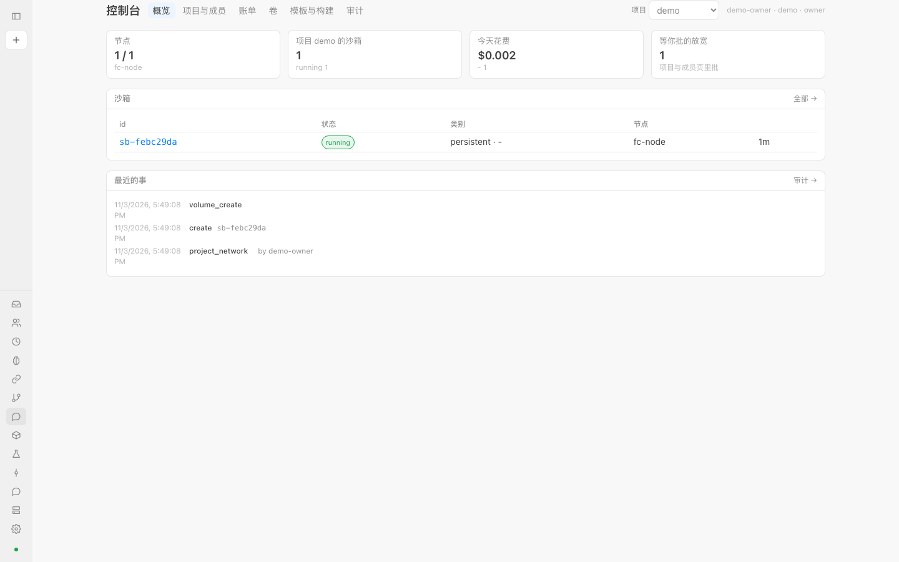

## 1. Signing in and tokens

1. Ask the **owner** of your project for a token. When the owner adds you as a member under "Console → Projects and members", the page shows a line "<name>'s token (shown only once)" for them to copy to you. Once the page is closed it can never be shown again; if you lose it, the owner has to issue a new one.
2. Open the workbench at `http://<control-plane>:18700/ui/`. If the token is wrong or missing, a "Sign in" dialog appears; paste the token and press Enter. You can also enter it in the Token box under "Settings → Control plane" and click "Save"; the page reloads.
3. The token is kept in your browser's local storage (this browser only); "Sign out" at the bottom of the sidebar clears it.
4. After signing in, the top right of the console shows `user · account · role`, so you can confirm who you are and whether you are an owner or a member.

**Rotating a token**: the owner clicks "Rotate token" to the right of your name under "Projects and members" and may set a lifetime (seconds; empty = never expires). The new token is shown only once and the **old token stops working immediately** (your browser will show the sign-in dialog again). Members can also rotate their own (`POST /projects/<p>/members/<you>/rotate`). A token with a lifetime returns 401 once it expires.

**Connecting from code**: the same token goes in `Authorization: Bearer <token>` (the SDK reads `CAIRN_TOKEN`), and the project goes in the `X-Project` header (the SDK reads `CAIRN_PROJECT`); without a project you get your account's default project. See [SDK](sdk.md).

## 2. Accounts, projects, members: who can do what

Under "Console → Projects and members". One block per project: quota, default network, member list.

The "Project" drop-down in the top bar switches the project you are working in (it is written to `X-Project`; creating sandboxes, viewing quota and viewing billing all apply to it afterwards).

| Action | member | owner | admin (deployer) |
| --- | :-: | :-: | :-: |
| Create, use and delete sandboxes in this account's projects (exec, files, checkpoints, pause / resume / fork) | Yes | Yes | Yes |
| Create volumes, submit builds, use templates and layers | Yes | Yes | Yes |
| View this account's billing, quota, members, audit | Yes | Yes | All accounts |
| Tighten a sandbox's egress policy | Yes, takes effect immediately | Yes | Yes |
| Loosen a sandbox's egress policy | Submits a request, waits for approval (202) | Changes directly | Changes directly |
| Approve / reject a loosening request | No | Yes | Yes |
| Create projects, add / remove members, rotate tokens and lifetimes | Own token only | Yes | Yes |
| Change quota, change the project's default network | No | Yes | Yes |
| Settle billing (freeze a period) | No | Yes | Yes |
| Create accounts, change the price list, trigger metering manually | No | No | Yes |
| Nodes, migration, template / layer distribution to nodes, credential vault, verifying the audit hash chain | No | No | Yes |

Members see only their own account's resources; another account's sandbox is a 404 for you, and another account's project is a 403.

**Adding a member**: at the bottom of the project block, enter the user name (lowercase), choose `member` or `owner`, and click "Add"; the page gives you a one-time token. For the **quota**, three numbers (sandbox count, storage GiB, daily USD): 0 = unlimited; click "Save" after changing them.

## 3. Creating a sandbox

The "New" form at the top of the "Sandboxes" page:

| Field | Meaning |
| --- | --- |
| Template | Name of the base system image; the form is pre-filled with `debian-13`. To hot-start from a named template you built yourself, do not fill it in here; see section 7 |
| Memory MiB | This sandbox's memory, 512 by default |
| Class | `persistent`: **pauses** when idle time expires, can be resumed, and can be migrated; `ephemeral`: disposable, **destroyed** when idle time expires, and the first to be given up when resources are tight |
| Allowed domains | Hosts the sandbox may reach through the egress proxy, separated by commas or spaces, wildcards such as `*.suffix` supported; empty = use the project's default network (if no default is set, no external network is allowed) |

After clicking "Create" you land on the sandbox's detail page. The form covers only the four most common fields; **leaving allowed domains empty = use the project's default network** (not "all off"), and anything you fill in takes precedence over the default. To also set **volumes, environment variables, layers, a named template, priority, paused retention** and so on, use the SDK or `POST /sandboxes` (fields in [CONTRACT §1](../../../CONTRACT.md) and [api/sandboxes.md](api/sandboxes.md)):

```python
from cairnsandbox import Client
c = Client()    # CAIRN_URL / CAIRN_TOKEN / CAIRN_PROJECT
sb = c.sandboxes.create(mem=1024, cls="persistent", env={"MODE": "dev"},
                        network={"allow_hosts": ["pypi.org"]}, retain_paused_s=86400)
```

Creation is admitted against the project quota first; if you exceed it, see section 14.

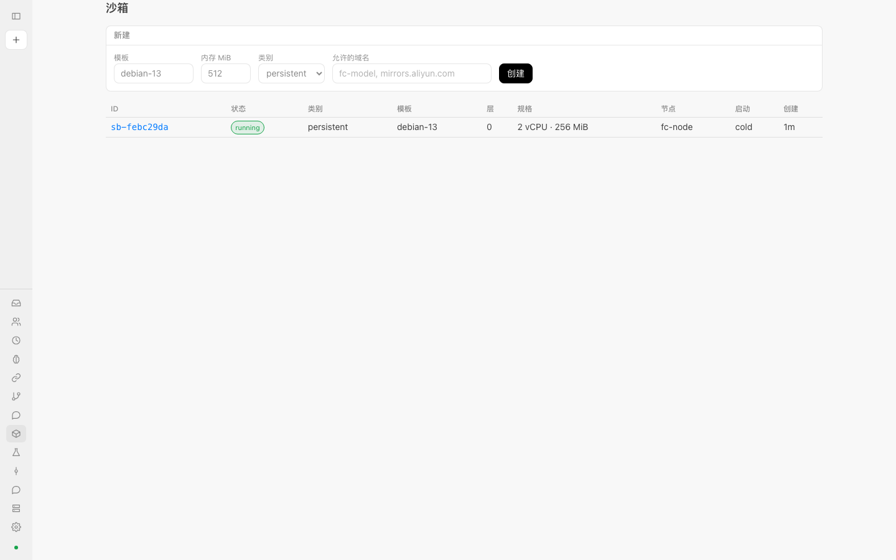

## 4. What the sandbox detail page can do

Click a row in the list to open the detail page.

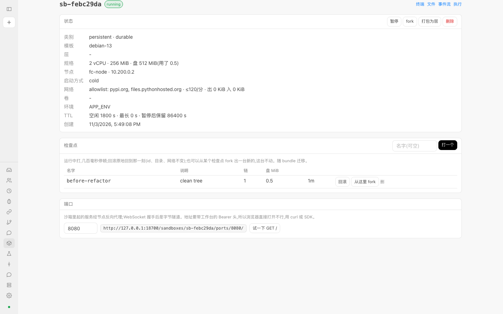

The **status card** lists class, template, layers, spec (vCPU / memory / disk and used), node, boot method (cold / snapshot), network (mode, allowed domains, per-minute request limit, bytes out and in), volumes, environment variable names, and TTL (idle, maximum, retention after pause). The buttons at the top right:

- **Pause / Resume**: a running sandbox shows "Pause", a paused one shows "Resume". After pausing, memory and disk are written to storage and CPU and memory are no longer metered. Running a command against, or accessing a port of, a paused sandbox resumes it automatically first.
- **Fork**: clones one (copy-on-write) and jumps to the new sandbox; the parent is untouched.
- **Pack as layer**: asks for a layer name, freezes this sandbox's writable layer into a read-only layer and shows the layer id; later, when creating a sandbox, you can stack it with `layers=[id]`.
- **Delete**: destroys it after confirmation.

**Checkpoints** card: enter a name (may be empty) in the "Name" box and click "Take one". Taking one while running causes a pause of a few hundred milliseconds, after which it keeps running. Name format `[a-z0-9][a-z0-9_.-]{0,39}`; a duplicate name gives 409. Each row has:

- **Roll back**: return to that moment in place; the id, directory and network are unchanged, and later changes are discarded (asks for confirmation first).
- **Fork from here**: creates a new sandbox starting from that checkpoint's memory and disk; this one is untouched.
- **Delete**: deletes the checkpoint.

**Ports** card: enter the port your service in the sandbox listens on; the page gives the address `http://<control-plane>/sandboxes/<id>/ports/<port>/`, and "Try GET /" makes one request with your token. This address needs an `Authorization: Bearer` header, so pasting it straight into the browser's address bar does not work (section 14); use `curl -H "Authorization: Bearer …"` or the SDK's `sb.ports.get(port)`. A request with `Upgrade: websocket` becomes a byte tunnel after the handshake (`sb.ports.websocket(port)`).

The "Terminal / Files / Event stream / Exec" buttons at the top right of the detail page open the matching panel in the right rail (any page can also open them with `?rail=<name>&sandbox=<id>`; the right rail also has a "diff" panel that shows the repository branch in the sandbox against the baseline, with its parameters given in the address):

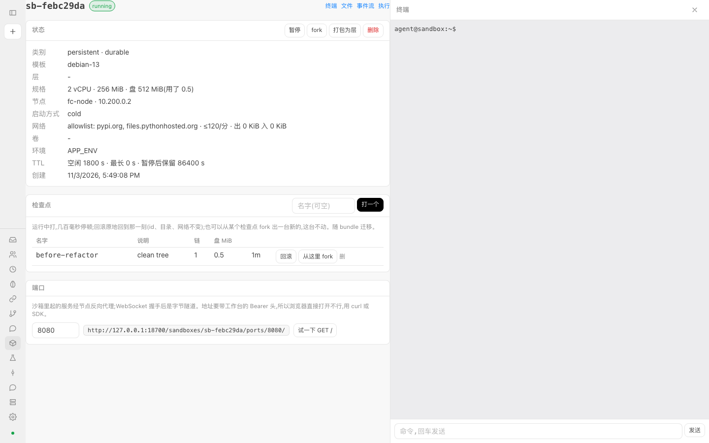

- **Terminal**: opens a PTY session in the sandbox as `agent`; type a line and press Enter to send it, and output scrolls in real time. It is a line-at-a-time input box, not a full terminal emulator.
- **Exec**: a one-off command, with stdout / stderr streamed; you can choose `agent` or `root`, and at the end it shows the exit code and elapsed time.
- **Files**: browse directories and view text file contents (read-only; for binary files only the size is shown); to write files use the SDK's `sb.files.write`.
- **Event stream**: events recorded by the sandbox kernel (model calls, reports, notes, checkpoints), refreshed every two seconds.

## 5. Egress policy

There is no DNS inside the sandbox; every outbound connection goes through the node's egress proxy, which allows or denies it according to policy, and every decision is recorded. The shape of the policy is the same everywhere (the `network` on sandbox creation, `PUT /sandboxes/<id>/network`, and the project default network):

| Field | Meaning |
| --- | --- |
| `mode` | `closed` (default) and `allowlist`: when no rule matches, only what is in `allow_hosts` is allowed (empty = deny all); `audited`: when no rule matches, allow, and record everything. The order from strict to loose is `closed` < `allowlist` < `audited` |
| `allow_hosts` | Allowed hosts: exact names, `*.suffix`, or globs |
| `allow_direct` | Addresses allowed for direct connection (not via the proxy list; written as addresses, such as CIDRs) |
| `rules` | Ordered rules; the first match wins: `{name, match:{scheme, host, method, path}, action:{allow, inject}}`. `host` may be written as `~regex`; `method` and `path` only apply to plaintext HTTP (for an HTTPS tunnel only the host and port are visible); `inject` adds the request header of a credential from the vault to plaintext HTTP requests, so the secret never enters the sandbox |
| `limits` | `requests_per_min`, `max_bytes`: per-sandbox limits on proxied requests per minute and cumulative bytes; beyond them the proxy returns 429 |

**Where to change it**:

- The project's **default network** is under "Projects and members", one row per project: choose a mode, fill in the allowed domains (comma-separated) and requests per minute, and click "Save"; "Delete default" removes it. It is used **only when the request creating a sandbox carries no `network`**; if one is given, the request wins (with the SDK and API, omitting `network` means the default is used).
- A single sandbox's policy can only be **viewed** on its detail page; to change it use the SDK: `sb.network.set(allow_hosts=[...])`, or `PUT /sandboxes/<id>/network`. To see the latest 200 outbound decisions: `sb.network.decisions()`, i.e. `GET /sandboxes/<id>/egress`.

**Tightening and loosening differ**:

- Tightening (a stricter mode, removing domains, removing allow rules, lowering limits) takes effect immediately.
- Loosening (a looser mode, newly allowed domains or direct addresses, new allow rules or removing deny rules, raising or removing limits): if you are a **member**, the request gets **202** and a request `nr-…`, and nothing on the node changes; if you are an owner or admin it takes effect directly. In the SDK this raises `NeedsApproval`, and `.request` is that request.
- **Where approval happens**: at the very top of "Console → Projects and members" there is a block "Egress loosenings waiting for you (N)" listing the sandbox, who asked, and what they want; the owner clicks "Approve" to push it to the node, or "Reject". The "Loosenings waiting for you" tile on the overview page shows the same number. Members see "Waiting for owner".

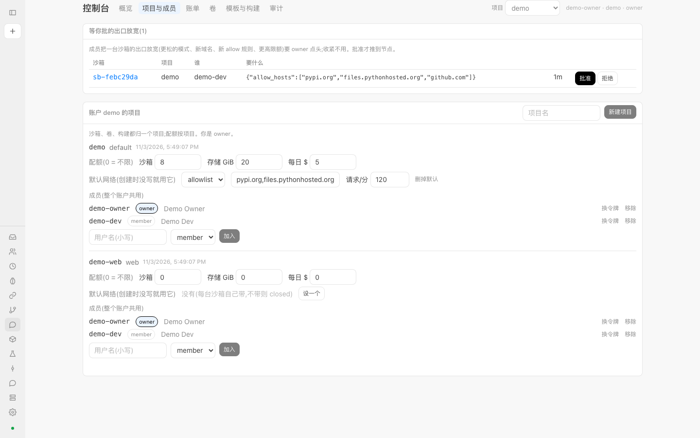

## 6. Volumes

"Console → Volumes". A volume is a disk (an ext4 image) with an independent lifecycle; it lives on one node and is not destroyed with a sandbox.

- **Create**: choose the project, enter a name, enter the size (MiB, default 1024), and click "New". The list shows the id, project, node, size (allocated / total), and which sandboxes it is attached to (`rw` / `ro`).
- **Attach to a sandbox**: pass `volumes` when creating the sandbox, with values that are a volume id or `{id, mount, ro}` (`mount` defaults to `/mnt/<name>`):

  ```python
  c.sandboxes.create(volumes=[{"id": vol["id"], "mount": "/mnt/data"}])
  c.sandboxes.create(volumes=[{"id": vol["id"], "ro": True}])
  ```

  A sandbox with volumes is placed on the node where the volume lives, and cold-starts (the template snapshot has no volume device).
- **Single writer, multiple readers**: a volume permits only one writer at a time; there can be several readers, but they cannot coexist with the writer, and a conflict gives 429.
- **It travels with the sandbox**: pause / resume keeps the mount; destroying the sandbox detaches it; migrating a sandbox migrates its volumes too (if a volume is still attached to another sandbox, 409 and nothing is moved). Takeover after a node dies does not bring volumes.
- **Delete**: click "Delete" at the end of the row and confirm; a volume that is still attached cannot be deleted (409).

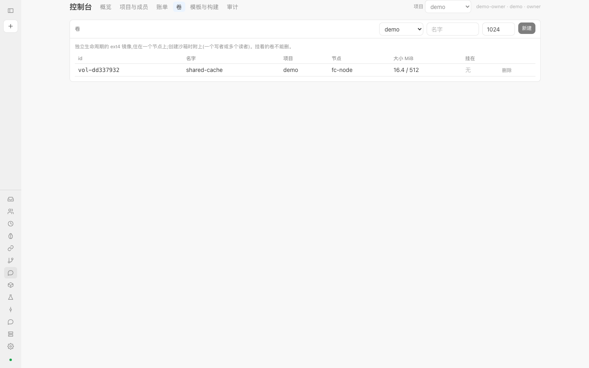

## 7. Templates, layers and builds

"Console → Templates and builds". Three objects: **layers** (read-only filesystem deltas, with ids like `L-xxxxxxxx`), **templates** (named snapshots including memory, from which new sandboxes hot-start), and **builds** (the asynchronous jobs that produce them).

- **OCI image → layer**: in the build header choose "OCI image → layer", enter the image name (such as `python:3.12-slim`) and an optional layer name, and click "Start". The node pulls the image's root filesystem from the registry and makes it into a read-only layer stacked on our base.
- **Sandbox → template**: choose "Sandbox → template", enter the sandbox id and a template name, and click "Start". That sandbox's memory and disk at this moment become the template; afterwards, creating a sandbox with `template_key="<template name>"` hot-starts from it, with the in-memory processes present too.
- Each row of the builds table has id, kind, input, node, status (`running` / `done` / `failed`), and result (layer id or template key) or error; while a job is running it refreshes automatically every 3 seconds.
- **Distribution matrix**: with several nodes there is an extra table "Which nodes have the template"; filled means present, hollow means absent. Hollow cells must be filled by the deployer with `POST /templates/everywhere` and `POST /layers/<id>/everywhere`.
- Templates and layers are shared artifacts on the nodes and are usable by members; builds belong to your own project.

For a complete example, see the tutorial [Turn your own Docker image into a template](tutorials/custom-template.md).

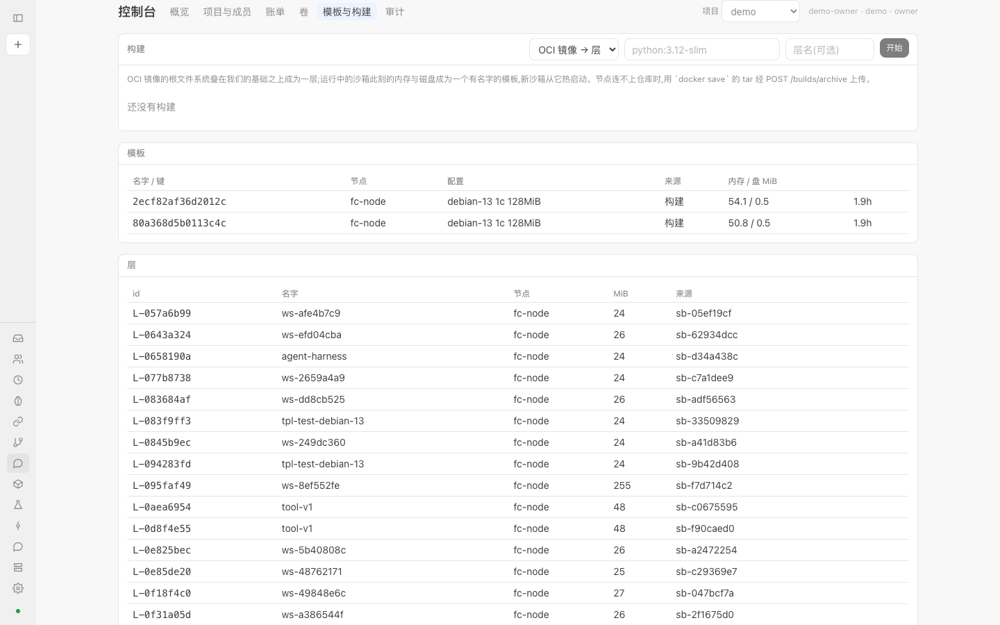

## 8. Billing

"Console → Billing"; choose a project first.

- The top line: how much has been spent **today**, the **last 30 days** total, and how many sandboxes were involved. Below, one row per usage kind: quantity, number of records, cost. The usage kinds are vCPU-seconds, memory MiB-seconds, disk MiB-seconds, egress bytes, and model tokens (input / output / cache).
- **Settled**: the owner clicks "Settle up to now" to freeze the billing from the last settlement to this moment into one row, which is not changed even if prices or usage change later; the first one is computed from the beginning, and one that overlaps an already settled period is rejected (400). Each row shows the id, period, sandbox count and cost.
- **CSV**: "Last 30 days CSV" exports the same statement, one row per usage kind and a total on the last row. The button fetches the data with the token you are signed in with and saves it as a file; in scripts use the SDK's `c.billing.statement_csv()`, or `curl -H "Authorization: Bearer …" '<control-plane>/metering/projects/<project>/statement?from=<seconds>&format=csv'`.
- **Price list**: USD per unit, with a version number. Read-only for members; the deployer can edit it and "Save as new version". Model token prices are set per model by the model proxy and are not in this table.
- The deployer also has a "Meter now" button; normally the system meters automatically once a minute.

The daily spending quota (the project's `daily_usd`) limits new sandbox creation based on the "today" figure; see section 14.

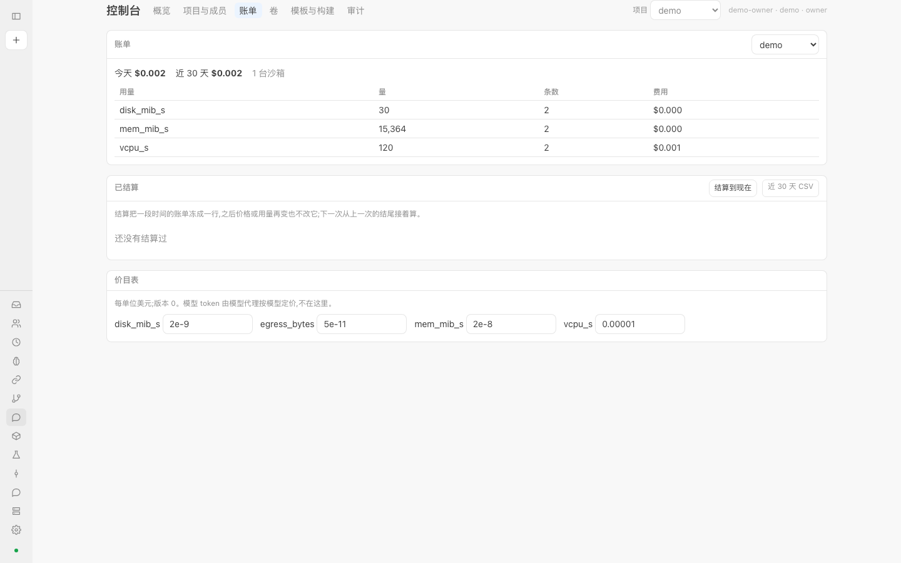

## 9. Audit

"Console → Audit": one row for everything the control plane has done, append-only, forming a hash chain. Columns: time, op, project, sandbox, who, details.

- **Filtering**: a project drop-down (for members "this account", for the deployer "all projects"), an "op contains…" text box, and a row count (50 / 200 / 1000).
- Members see only rows of their own account's projects; rows with no project attribution are visible only to the deployer.
- "Recent activity" in the lower half of the overview page is the latest 12 rows from here.
- **Verifying the hash chain** (deployer): each row carries the hash of the previous row, so if a row is modified or deleted, the chain breaks from there on. Clicking the button shows "Hash chain intact: N rows" or "Chain broken from row N" (endpoint `GET /audit/verify`).
- This is the control plane's audit; each node's own audit lives on the node. With multiple replicas, `GET /audit` returns the log tail of the replica that was asked.

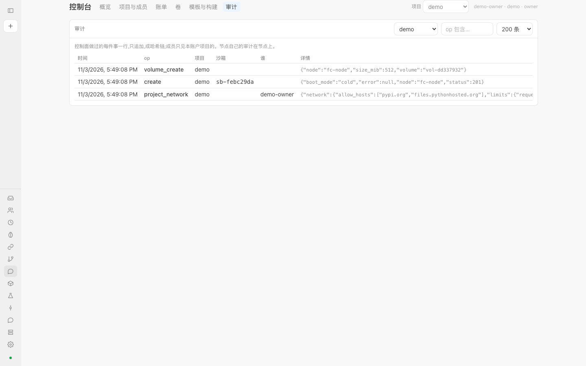

## 10. Personal directory (My directory)

"My directory" (`#/home`) is the harness directory you bring into every agent task: rules (`rules/*.md`, one file per rule), notes (`memory.md`), prompt templates (`prompts/…`), skills (`skills/<name>/SKILL.md`), `config.json`, and middleware. For the format see [CONTRACT §5a](../../../CONTRACT.md).

- The file list is on the left; click one to edit it on the right and click "Save"; "Delete" deletes a file; at the bottom enter a path (such as `rules/02.md`) and click "New".
- **Human edits take effect immediately**: there is no approval step. After saving, the next time work is dispatched this directory is sent into the sandbox, read-only at `/work/home`. The page header shows the directory's version (a content digest `h-…`).
- When the directory fails `check` (for example `instance.md` is missing `{{task}}`, or there are more than 30 rules), the problems are listed at the top of the page, and a directory like that does not run.
- **Machine proposals need your apply**: the evolver can only write proposals into `proposals/<id>/`; the page only **lists** them ("Machine proposals (awaiting your apply)") and does not move them for you. To adopt one, run `python -m aios.home apply <id>` on the machine where the directory lives; after apply, a record is appended to `history.jsonl`, and if `check` fails it is put back as it was.

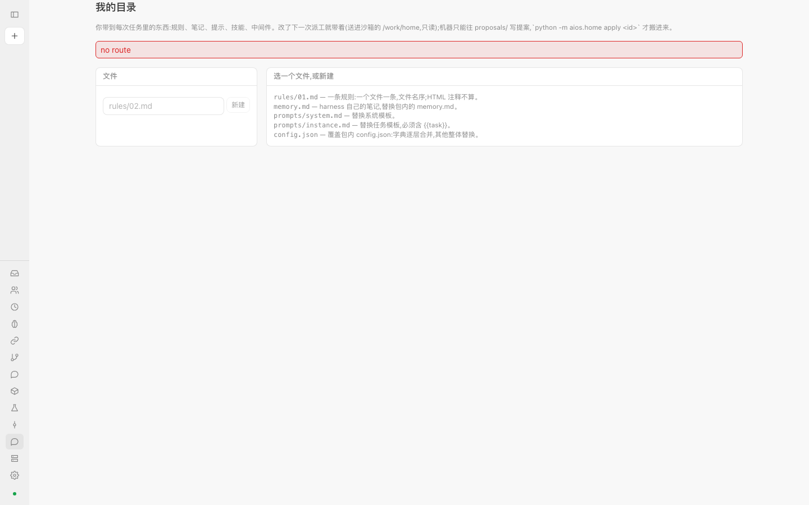

## 11. Overview page

"Console → Overview" is the first screen every time you come in: the number of live nodes and each node's state, this project's sandbox count (by state), today's spend (by priority), loosenings waiting for your approval, this project's sandbox table, and recent activity.

## 12. For agents

- Let an agent such as Claude Code use sandboxes as a tool: [tutorial](tutorials/claude-code-mcp.md), [MCP reference](mcp.md).
- Give a sandbox a budget, write a ticket, send input, wait for a report: [tutorial](tutorials/budget-and-ticket.md).
- Migrating from E2B: [tutorial](tutorials/migrate-from-e2b.md).

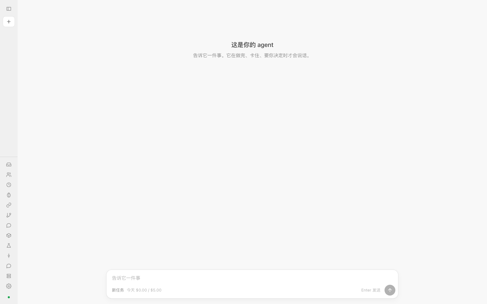

## 13. Where it is deployed and how to connect

The deployer will tell you the address. By default the workbench and HTTP / SDK are on **18700** (the workbench is `/ui/`), and the E2B-shaped port is on **18710**; the ports bind only to 127.0.0.1, so for external access put a reverse proxy in front ([deploy/README.md](../../../deploy/README.md)).

## 14. Troubleshooting

**429: no capacity, or a quota was hit.** Look at the `error` in the response:

- `quota: sandboxes`: this project's sandbox count has reached the limit (the quota's `max_sandboxes`). Delete unused ones, or ask the owner to raise it.
- `quota: storage`: this project's writable layers plus volumes plus the disk requested this time exceed `max_storage_gib`; the response carries `used_mib` and `asked_mib`.
- No node has room / memory: retry later, or pause or delete other sandboxes. `batch` and `background` priorities are only placed on nodes that still have headroom; `interactive` takes precedence.
- The volume is being written by someone else: the same volume cannot have two writers at once (see section 6).
- Your token makes too many requests per minute: non-admin tokens have a per-minute limit; the response carries `Retry-After`, so wait that many seconds.
- In the SDK all 429s are `NoCapacity`.

**402: daily budget.** The response says `quota: daily budget`: the project's spend today has reached `daily_usd` in the quota. Wait until tomorrow, or ask the owner to raise it. In the SDK it is `QuotaExceeded`. Also, when model calls inside a sandbox exceed **that sandbox's budget**, the model proxy also returns 402 (see the [budget tutorial](tutorials/budget-and-ticket.md)).

**Why was the sandbox paused?** Common causes: a `persistent` sandbox was idle until `ttl_idle_s` and paused automatically; when resources are tight, `background` / `batch` sandboxes are paused first to make room for `interactive` requests (`persistent` ones are only paused, not killed; `ephemeral` ones may be terminated); during a node upgrade, persistent sandboxes are paused to disk and then resumed. Pausing loses nothing; click "Resume", or just run a command or access a port and it resumes automatically. If `retain_paused_s` is set, a sandbox paused longer than that is deleted (0 = keep forever). An `ephemeral` sandbox whose idle time expires is destroyed directly, not paused.

**Why does loosening egress return 202?** Because you are a member: loosening needs the owner's nod. The 202 response contains the request id, and the node has not changed; it takes effect only after the owner approves, whereas tightening takes effect immediately. See section 5.

**Why can't the browser open a port directly?** The port address needs an `Authorization: Bearer <token>` header, and ordinary navigation from the address bar does not carry it. Use `curl -H "Authorization: Bearer $CAIRN_TOKEN" <address>`, the detail page's "Try GET /", or the SDK's `sb.ports.get()`; for WebSocket use `sb.ports.websocket()`. If nothing is listening on the port it returns 502, and an invalid port number gives 400.

**Token lost / expired (401)?** Ask the owner to rotate your token (section 1); a token with a lifetime also has to be replaced when it expires.

**Can't delete a volume (409)?** It is still attached to a sandbox. Delete that sandbox first, or wait for it to be destroyed.

**Build failed?** The "Result" column of the builds table shows the error. When the node cannot reach the image registry, upload a `docker save` archive instead; see the [custom template tutorial](tutorials/custom-template.md).

## 15. Opening an account with an invite code

The platform gives you a one-time invite code (`inv_…`). Open the new console's sign-in page, click "Have an invite code? Create an account", and fill in the invite code, the account name (lowercase letters, digits, `_`, `-`, 2–32 characters) and your user name. On success your token is **shown only once**; save it before clicking "Open the console". You are the new account's **owner**. An invite code may carry starting credit (the account automatically becomes prepaid) and a trial quota (concurrent sandboxes, daily budget), visible under "Project settings" and "Usage and billing". If the name is taken the invite code is not voided; pick another name and try again.

## 16. API keys (for CI, scripts, dashboards)

Do not put a personal token in CI. The owner creates a **named key** in the "API keys" section of the "Members and keys" page: choose the access (Member = read/write, Viewer = read-only), the number of valid days (0 = never expires), and click "Create key"; the **secret is shown only once**. A key can access only the current project; a viewer key gets 403 `read-only credential` on any write operation; a key cannot create further keys and has no owner privileges. The list shows when each key was last used; when it is no longer needed, click "Revoke" and it stops working from the next request. Usage is the same as a token: `Authorization: Bearer cairn_…`, and in the SDK `Client(token="cairn_…")`.

## 17. Prepaid credit and balance

If your account is **prepaid**: the "Usage and billing" page has an extra block "Balance (prepaid)". Balance = cumulative top-ups − cumulative spend of all projects. **When it drops to 0**: creating a sandbox gets 402 `quota: out of credit`, and the account is suspended (running sandboxes are paused with their state kept, and a red notice appears at the top of the page); **it recovers immediately after a top-up** (you click resume yourself on the sandboxes you want back). To top up, contact the platform (the deployer), who will record a credit for you; an owner can check the balance and the latest 20 ledger entries with `GET /accounts/<account>/balance`.

## 18. Opening a service in a sandbox from the browser (preview domains)

If the platform has enabled a preview domain (`PREVIEW_DOMAIN`), a web service listening on port 8080 in the sandbox can be opened directly in the browser at `https://8080-<sandbox id>.<preview domain>/?token=<your token>`: on the first visit the token is stored in an HttpOnly cookie valid only for this site and the page redirects to remove the token from the address bar, after which sub-requests from the page carry it automatically. The token is your member token, so **do not send this link to anyone else** (it would leak the token); to show it to someone else, have them sign in to their own account.

## 19. Service status

`https://<control-plane>/status` (JSON) and `/console/status/` (page) require no sign-in and show the state of five components: API, routing registry, database, storage, and sandboxes. HTTP 503 means a service outage. To work out "is it the platform or is it me", look here first.
