# 租户手册

给在 CairnSandbox 沙箱云里**用**沙箱的人:成员、项目 owner。按任务写,每节回答"我要做 X,点哪里、填什么、会发生什么"。界面以工作台的「控制台」(`#/cloud`)、「沙箱」(`#/sandboxes`)、「我的目录」(`#/home`)三处为准;界面上没有的操作,这里给 SDK 或 HTTP 的写法,端点细节在 [API 参考](api/README.md)。

> **新控制台**:沙箱云现在有独立的控制台 `http://<控制面>:18700/console/`(D51),按角色显示不同导航,中英文。下面第 1–14 节写的是工作台里的旧控制台,概念与权限不变;**新增的能力**(邀请码开户、API 密钥、预付额度、预览域名、状态页)写在第 15–19 节。

先认三个词:

- **账户 ⊃ 项目 ⊃ 成员**。沙箱、卷、构建都归一个**项目**,配额、账单、默认网络也按项目。成员是整个账户共用的一组人。
- **部署者**(admin)就是持有部署时那枚 `cp.token` 的人,是所有账户的 admin。
- 工作台(`/ui/`)和 HTTP / SDK 用同一个控制面;E2B 形状的口在另一个端口,见[从 E2B 迁移](tutorials/migrate-from-e2b.md)。

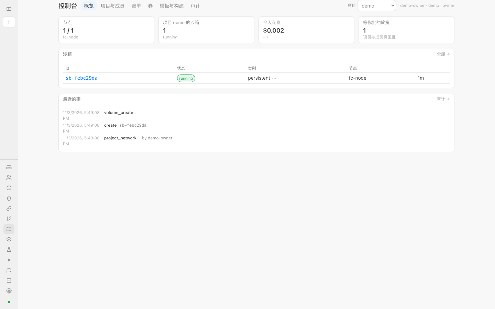

## 1. 登录与令牌

1. 向你所在项目的 **owner** 要一枚令牌。owner 在「控制台 → 项目与成员」里把你加为成员时,页面上出现一行"某某 的令牌(只显示这一次)",抄给你。关掉页面就再也看不到,丢了只能让 owner 换一枚。
2. 打开工作台 `http://<控制面>:18700/ui/`。令牌不对或没填时会弹出"登录"对话框,粘进去回车即可。也可以到「设置 → 控制面」的 Token 框里填,点"保存",页面重新加载。
3. 令牌存在你浏览器的本地存储里(只在这个浏览器);侧栏底部的"退出"清掉它。
4. 登录后,控制台右上角会写 `用户 · 账户 · 角色`,可以据此确认你是谁、是 owner 还是 member。

**换令牌**:owner 在「项目与成员」里点你名字右边的"换令牌",可填有效期(秒,留空 = 不过期)。新令牌只显示一次,**旧令牌立刻失效**(你的浏览器会再弹出登录框)。成员本人也能给自己换(`POST /projects/<p>/members/<你>/rotate`)。有有效期的令牌到期后返回 401。

**用代码接入**时同一枚令牌放在 `Authorization: Bearer <令牌>`(SDK 读 `CAIRN_TOKEN`),项目放在 `X-Project` 头(SDK 读 `CAIRN_PROJECT`);不给项目就是你账户的 default 项目。详见 [SDK](sdk.md)。

## 2. 账户、项目、成员:谁能做什么

在「控制台 → 项目与成员」。每个项目一块:配额、默认网络、成员列表。

顶栏的"项目"下拉框切换你当前操作的项目(它被写进 `X-Project`,之后建沙箱、看配额、看账单都针对它)。

| 能做的事 | member | owner | admin(部署者) |
| --- | :-: | :-: | :-: |
| 建、用、删本账户项目里的沙箱(执行、文件、检查点、暂停 / 恢复 / fork) | 是 | 是 | 是 |
| 建卷、提交构建、用模板和层 | 是 | 是 | 是 |
| 看本账户的账单、配额、成员、审计 | 是 | 是 | 全部账户 |
| 收紧沙箱的出口策略 | 是,立即生效 | 是 | 是 |
| 放宽沙箱的出口策略 | 提交申请,等批(202) | 直接改 | 直接改 |
| 批准 / 拒绝放宽申请 | 否 | 是 | 是 |
| 新建项目、加 / 移除成员、换令牌与有效期 | 只能换自己的令牌 | 是 | 是 |
| 改配额、改项目默认网络 | 否 | 是 | 是 |
| 结算账单(冻结一段时间) | 否 | 是 | 是 |
| 新建账户、改价目表、手动计一次量 | 否 | 否 | 是 |
| 节点、迁移、模板 / 层分发到各节点、凭证保险库、核对审计哈希链 | 否 | 否 | 是 |

成员只看得到自己账户的东西;别账户的沙箱对你是 404,别账户的项目是 403。

**加一个成员**:在项目块底部填用户名(小写)、选 `member` 或 `owner`,点"加入";页面给出一次性令牌。**配额**三个数(沙箱数、存储 GiB、每日美元)填 0 = 不限,改后点"保存"。

## 3. 建一台沙箱

「沙箱」页顶部的"新建"表单:

| 字段 | 含义 |
| --- | --- |
| 模板 | 基础系统镜像的名字,表单预填 `debian-13`。要用你自己做的命名模板热启动,不在这里填,见第 7 节 |
| 内存 MiB | 这台沙箱的内存,默认 512 |
| 类别 | `persistent`:空闲到期后**暂停**,可恢复,也能被迁移;`ephemeral`:用完即弃,空闲到期**销毁**,资源紧张时最先被让出 |
| 允许的域名 | 沙箱经出口代理能访问的主机,逗号或空格分隔,支持 `*.后缀` 这样的通配;留空 = 用项目的默认网络(没设默认则不放行任何外网) |

点"创建"后跳到这台沙箱的详情页。表单只覆盖最常用的四项;**允许的域名留空 = 用项目的默认网络**(不是"全关"),填了就以表单为准。要带**卷、环境变量、层、命名模板、优先级、暂停保留期**等,用 SDK 或 `POST /sandboxes`(字段见 [CONTRACT §1](../../CONTRACT.md) 与 [api/sandboxes.md](api/sandboxes.md)):

```python
from cairnsandbox import Client
c = Client()    # CAIRN_URL / CAIRN_TOKEN / CAIRN_PROJECT
sb = c.sandboxes.create(mem=1024, cls="persistent", env={"MODE": "dev"},
                        network={"allow_hosts": ["pypi.org"]}, retain_paused_s=86400)
```

创建前会按项目配额准入,超了见第 14 节。

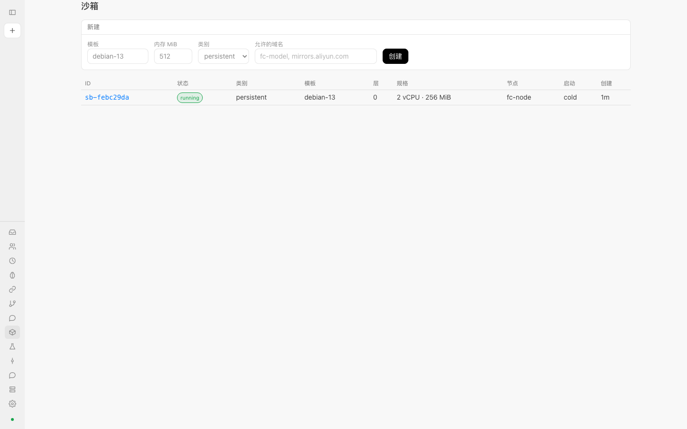

## 4. 沙箱详情能做什么

点列表里的一行进入详情页。

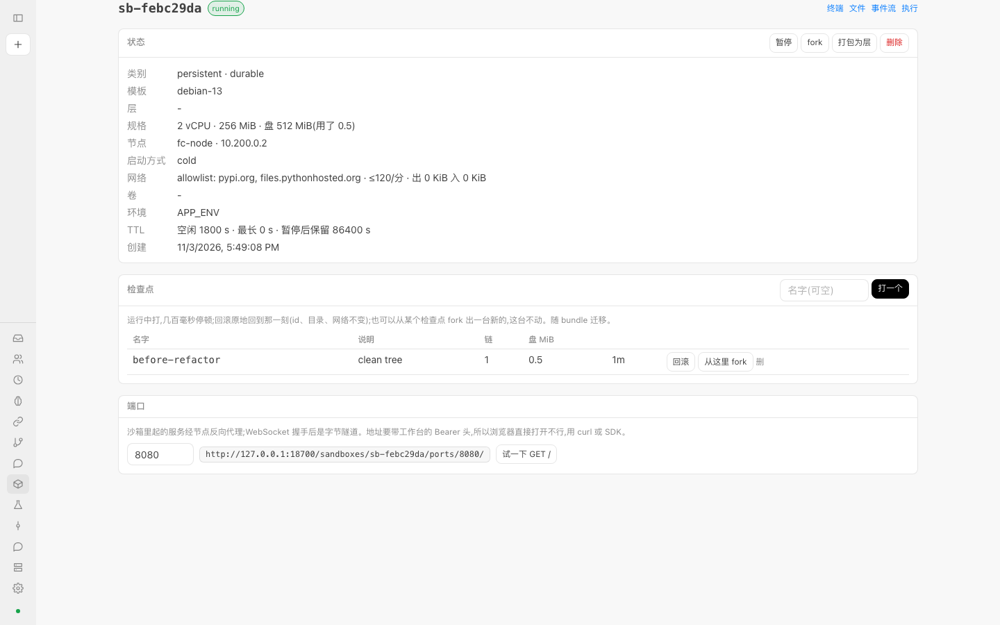

**状态卡**列出类别、模板、层、规格(vCPU / 内存 / 盘与已用)、节点、启动方式(cold / snapshot)、网络(模式、放行域名、每分钟请求上限、出入字节)、卷、环境变量名、TTL(空闲、最长、暂停后保留)。右上角的按钮:

- **暂停 / 恢复**:运行中显示"暂停",暂停中显示"恢复"。暂停后内存与磁盘落盘,不再计 CPU 和内存。对暂停的沙箱执行命令或访问端口,会先自动恢复。
- **fork**:克隆一台(写时复制),跳到新沙箱;父沙箱不动。
- **打包为层**:问一个层名,把这台沙箱的可写层固化成只读层,弹出层 id;之后创建沙箱时可用 `layers=[id]` 叠上去。
- **删除**:确认后销毁。

**检查点**卡:在"名字"框填名字(可空)点"打一个"。运行中打,有几百毫秒的停顿,打完继续跑。名字格式 `[a-z0-9][a-z0-9_.-]{0,39}`,重名会报 409。每行有:

- **回滚**:原地回到那一刻,id、目录、网络都不变,之后的改动丢弃(会先确认)。
- **从这里 fork**:从该检查点的内存与磁盘出发新建一台,这台不动。
- **删**:删掉这个检查点。

**端口**卡:填沙箱里服务监听的端口,页面给出地址 `http://<控制面>/sandboxes/<id>/ports/<端口>/`,"试一下 GET /"会带你的令牌请求一次。这个地址需要 `Authorization: Bearer` 头,所以直接贴进浏览器地址栏打不开(第 14 节),用 `curl -H "Authorization: Bearer …"` 或 SDK 的 `sb.ports.get(port)`。带 `Upgrade: websocket` 的请求握手后变成字节隧道(`sb.ports.websocket(port)`)。

详情页右上角的"终端 / 文件 / 事件流 / 执行"在右栏打开对应面板(任何页面也可以用 `?rail=<名>&sandbox=<id>` 打开;右栏还有一个"diff"面板,看沙箱里仓库的分支对基线,参数写在地址里):

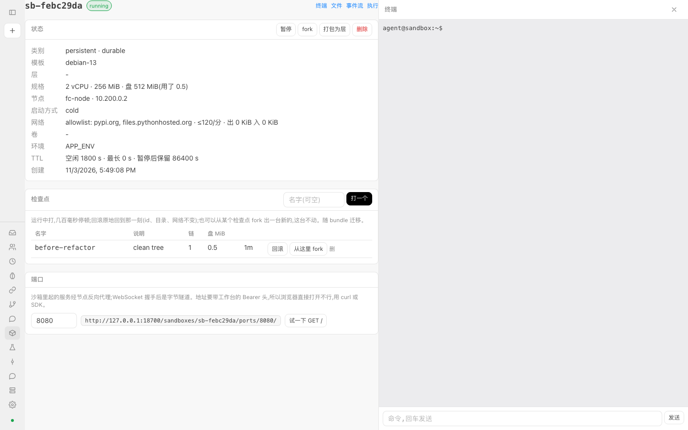

- **终端**:在沙箱里开一个以 `agent` 身份的 PTY 会话,输入一行命令回车发送,输出实时滚动。它是按行发送的输入框,不是完整的终端模拟器。
- **执行**:一次性命令,流式显示 stdout / stderr,可选 `agent` 或 `root`,结束时给出退出码和耗时。
- **文件**:浏览目录、看文本文件内容(只读,二进制只显示大小);写文件用 SDK 的 `sb.files.write`。
- **事件流**:沙箱内核记下的事件(模型调用、报告、笔记、检查点),每两秒刷新。

## 5. 出口策略

沙箱里没有 DNS,一切外连都走节点的出口代理,按策略放行或拒绝,每次决定都有记录。策略的形状(创建沙箱的 `network`、`PUT /sandboxes/<id>/network`、项目默认网络都一样):

| 字段 | 含义 |
| --- | --- |
| `mode` | `closed`(默认)与 `allowlist`:没有规则命中时只放 `allow_hosts` 里的(空 = 全拒);`audited`:没有规则命中时放行,全部记录。`closed` < `allowlist` < `audited` 是从严到松的顺序 |
| `allow_hosts` | 放行的主机,精确名、`*.后缀` 或 glob |
| `allow_direct` | 直连放行的地址(不经代理名单,按 CIDR 之类的地址写) |
| `rules` | 有序规则,第一条命中为准:`{name, match:{scheme, host, method, path}, action:{allow, inject}}`。`host` 可写 `~正则`;`method`、`path` 只对明文 HTTP 生效(HTTPS 隧道只看得到主机和端口);`inject` 把保险库里某个凭证的请求头加到明文 HTTP 请求上,密钥不进沙箱 |
| `limits` | `requests_per_min`、`max_bytes`:每台沙箱经代理的请求数 / 分钟和累计字节上限,超了代理回 429 |

**在哪里改**:

- 项目的**默认网络**在「项目与成员」里,每个项目一行:选模式、填放行域名(逗号分隔)、请求 / 分,点"保存";"删掉默认"撤掉它。创建沙箱时**请求里没带 `network` 才用它**,带了以请求为准(SDK 与 API 不传 `network` 就走默认)。
- 单台沙箱的策略在详情页只能**看**;改用 SDK:`sb.network.set(allow_hosts=[...])`,或 `PUT /sandboxes/<id>/network`。看最近 200 条出站决定:`sb.network.decisions()`,即 `GET /sandboxes/<id>/egress`。

**收紧与放宽不一样**:

- 收紧(更严的模式、去掉域名、去掉 allow 规则、调低限额)立即生效。
- 放宽(更松的模式、新放行的域名或直连地址、新的 allow 规则或撤掉 deny 规则、调高或去掉限额),如果你是 **member**,请求会得到 **202** 和一个申请 `nr-…`,节点上什么都没变;你是 owner 或 admin 则直接生效。SDK 里这会抛 `NeedsApproval`,`.request` 就是那份申请。
- **审批在哪里**:「控制台 → 项目与成员」最上面有一块"等你批的出口放宽(N)",列出沙箱、谁申请的、要什么,owner 点"批准"才推到节点,或点"拒绝"。概览页的"等你批的放宽"磁贴是同一个数。member 看到的是"等 owner"。

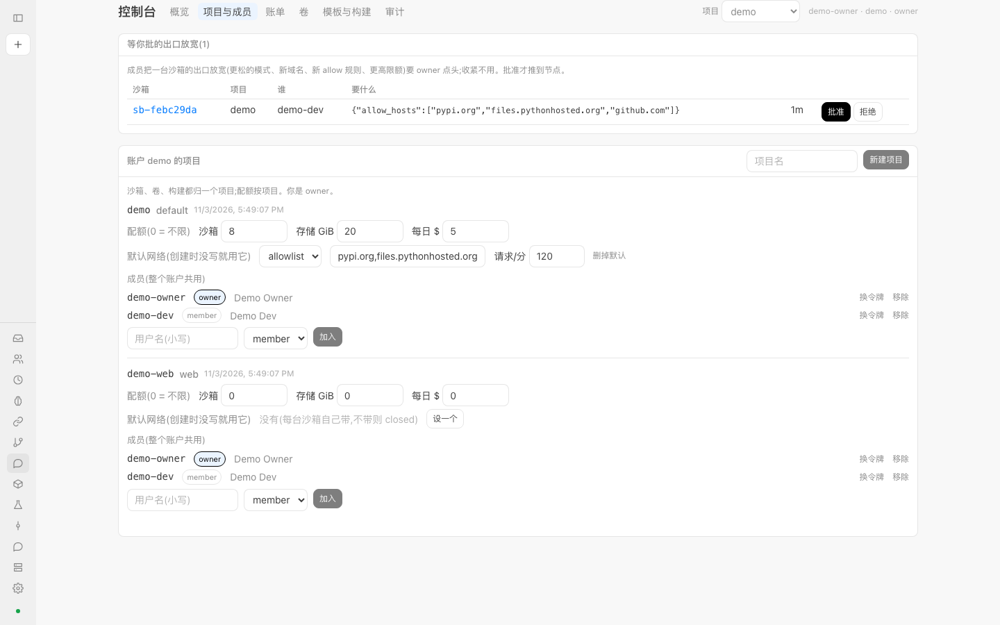

## 6. 卷

「控制台 → 卷」。卷是独立生命周期的磁盘(ext4 镜像),住在一台节点上,不随沙箱销毁。

- **建**:选项目、填名字、填大小(MiB,默认 1024),点"新建"。列表给出 id、项目、节点、大小(已分配 / 总量)、挂在哪些沙箱(`rw` / `ro`)。
- **附到沙箱**:创建沙箱时给 `volumes`,值是卷 id,或 `{id, mount, ro}`(`mount` 默认 `/mnt/<名字>`):

  ```python
  c.sandboxes.create(volumes=[{"id": vol["id"], "mount": "/mnt/data"}])
  c.sandboxes.create(volumes=[{"id": vol["id"], "ro": True}])
  ```

  带卷的沙箱会被放到卷所在的节点,并且冷启动(模板快照里没有卷设备)。
- **单写者多读者**:一个卷同一时刻只许一个写者;读者可以有多个,但不与写者共存,冲突时 429。
- **跟着走**:暂停 / 恢复保持挂载;沙箱销毁即解挂;迁移沙箱时卷一起迁(卷还被别的沙箱附着则 409,什么都不动)。节点死掉的接管不带卷。
- **删**:点行尾"删除"并确认;仍挂着的卷删不掉(409)。

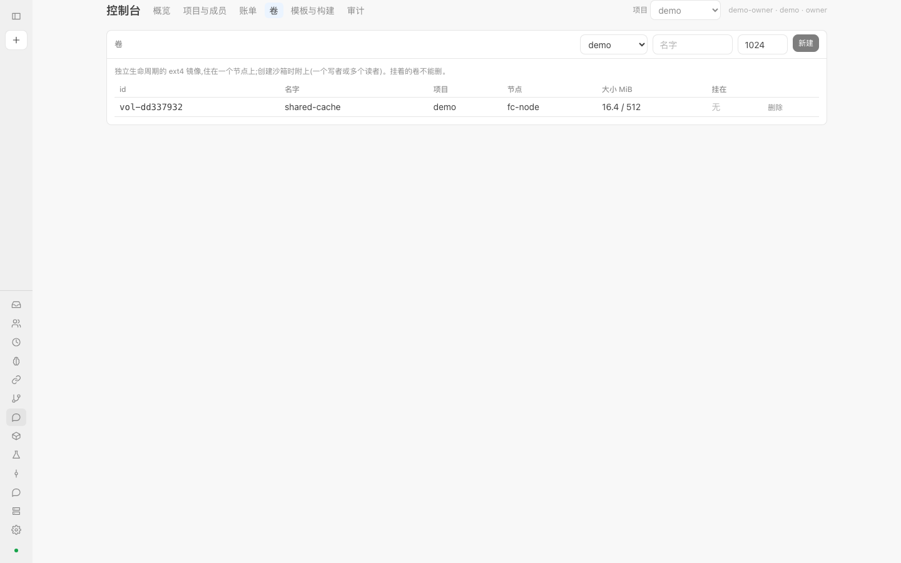

## 7. 模板、层与构建

「控制台 → 模板与构建」。三个对象:**层**(只读的文件系统增量,id 形如 `L-xxxxxxxx`)、**模板**(带内存的命名快照,新沙箱从它热启动)、**构建**(产出它们的异步任务)。

- **OCI 镜像 → 层**:构建表头选"OCI 镜像 → 层",填镜像名(如 `python:3.12-slim`)和可选的层名,点"开始"。节点从仓库拉镜像的根文件系统,做成叠在我们基础之上的只读层。
- **沙箱 → 模板**:选"沙箱 → 模板",填沙箱 id 和模板名,点"开始"。那台沙箱此刻的内存与磁盘成为模板;之后创建沙箱带 `template_key="<模板名>"`,从它热启动,内存里的进程也在。
- 构建表每行有 id、种类、输入、节点、状态(`running` / `done` / `failed`)、结果(层 id 或模板键)或错误;有任务在跑时每 3 秒自动刷新。
- **分发矩阵**:有多台节点时多一张"模板在哪些节点上",实心表示有、空心表示没有。空心要部署者用 `POST /templates/everywhere`、`POST /layers/<id>/everywhere` 补齐。
- 模板与层是节点上的共享制品,成员可用;构建归你自己的项目。

完整例子见教程[把自己的 Docker 镜像做成模板](tutorials/custom-template.md)。

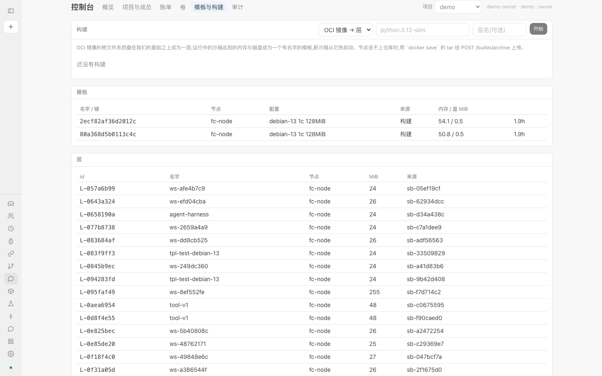

## 8. 账单

「控制台 → 账单」,先选项目。

- 顶上一行:**今天**已花多少、**近 30 天**合计、涉及几台沙箱。下面按用量种类一行:量、条数、费用。用量种类有 vCPU 秒、内存 MiB 秒、磁盘 MiB 秒、出站字节、模型 token(输入 / 输出 / 缓存)。
- **已结算**:owner 点"结算到现在",把上次结算之后到此刻的账单冻成一行,之后价格或用量再变也不改它;第一次从头算起,与已结算的时段重叠会被拒(400)。每行显示 id、时段、沙箱数、费用。
- **CSV**:"近 30 天 CSV"导出同一份账单,每种用量一行,末行是合计。按钮用你登录的令牌取数再存成文件;脚本里用 SDK `c.billing.statement_csv()`,或 `curl -H "Authorization: Bearer …" '<控制面>/metering/projects/<项目>/statement?from=<秒>&format=csv'`。
- **价目表**:每单位美元,带版本号。成员只读;部署者可改并"保存为新版本"。模型 token 的价由模型代理按模型定,不在这张表里。
- 部署者还有"现在计一次"按钮;平时系统每分钟自动计一次量。

每日花费配额(项目的 `daily_usd`)按"今天"这个数限制新建沙箱,见第 14 节。

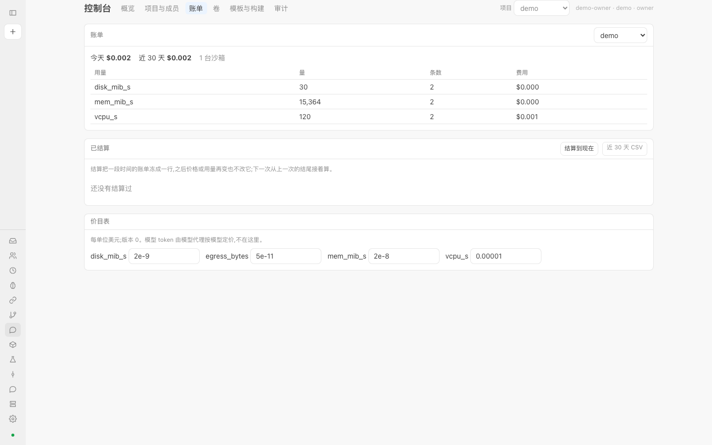

## 9. 审计

「控制台 → 审计」:控制面做过的每件事一行,只追加,成哈希链。列:时间、op、项目、沙箱、谁、详情。

- **过滤**:项目下拉(成员是"本账户",部署者是"所有项目")、"op 包含…"文本框、条数(50 / 200 / 1000)。
- 成员只看得到本账户项目的行;没有项目归属的行只有部署者看得到。
- 概览页下半的"最近的事"是这里最新的 12 条。
- **核对哈希链**(部署者):每行带前一行的哈希,改一行或删一行,从那里起链就断。点按钮会提示"哈希链完整:N 行"或"第 N 行起链断了"(接口 `GET /audit/verify`)。
- 这里是控制面的审计,节点自己的审计在节点上。多副本部署时 `GET /audit` 给的是被请求那个副本的日志尾部。

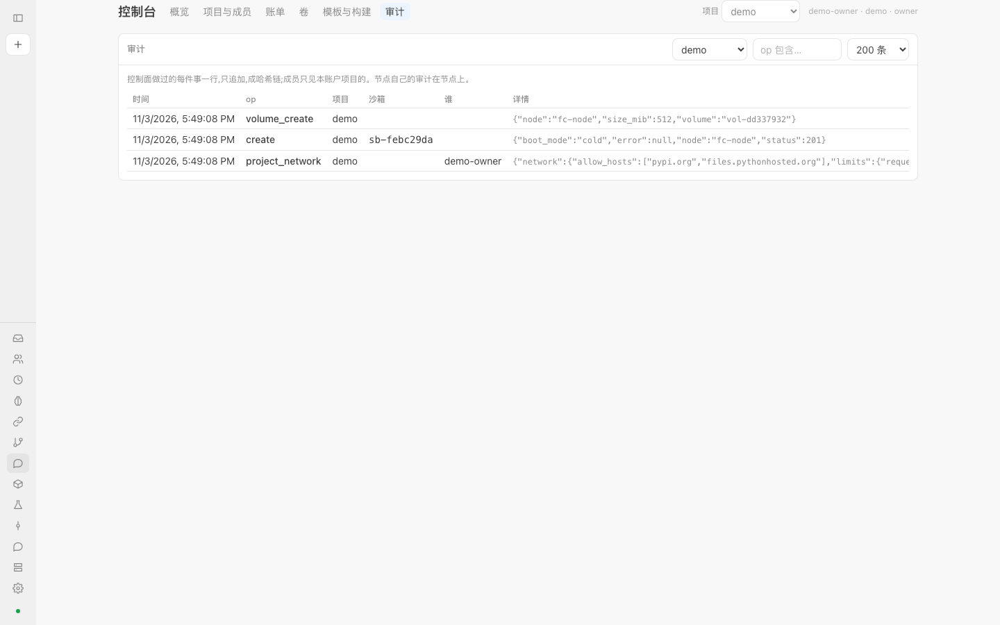

## 10. 个人目录(我的目录)

「我的目录」(`#/home`)是你带到每次 agent 任务里的 harness 目录:规则(`rules/*.md`,一个文件一条)、笔记(`memory.md`)、提示模板(`prompts/…`)、技能(`skills/<名>/SKILL.md`)、`config.json`、中间件。格式见 [CONTRACT §5a](../../CONTRACT.md)。

- 左边是文件列表,点开在右边编辑,点"保存";"删"删文件;底部输入路径(如 `rules/02.md`)点"新建"。
- **人改的立刻生效**:没有审批这一步。保存后,下一次派工起这份目录就送进沙箱,在 `/work/home` 只读。页头显示目录的版本(内容摘要 `h-…`)。
- 目录 `check` 不过(比如 `instance.md` 缺 `{{task}}`、规则超 30 条)时,问题列在页顶,这样的目录不开跑。
- **机器的提案要你 apply**:进化器只能往 `proposals/<id>/` 里写提案,页面只**列**出它们("机器的提案(待你 apply)"),不替你搬。要采纳,在目录所在机器上跑 `python -m aios.home apply <id>`;apply 之后会在 `history.jsonl` 追加一行记录,`check` 不过则原样放回。

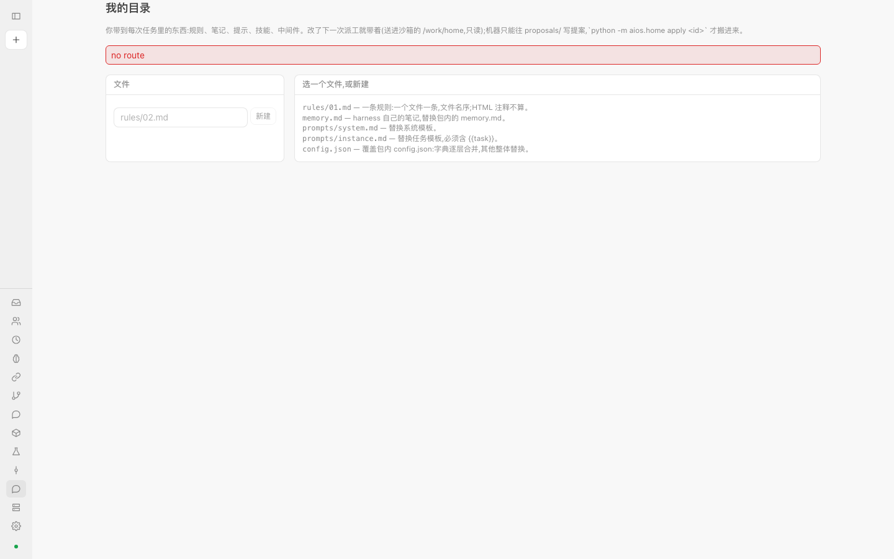

## 11. 概览页

「控制台 → 概览」是每次进来的第一屏:节点存活数与各节点状态、本项目沙箱数(按状态)、今天花费(按优先级分)、等你批的放宽、本项目的沙箱表、最近的事。

## 12. 给 agent 用

- 让 Claude Code 等 agent 把沙箱当工具:[教程](tutorials/claude-code-mcp.md)、[MCP 参考](mcp.md)。
- 给沙箱设预算、写工单、送输入、等报告:[教程](tutorials/budget-and-ticket.md)。
- 从 E2B 迁移:[教程](tutorials/migrate-from-e2b.md)。

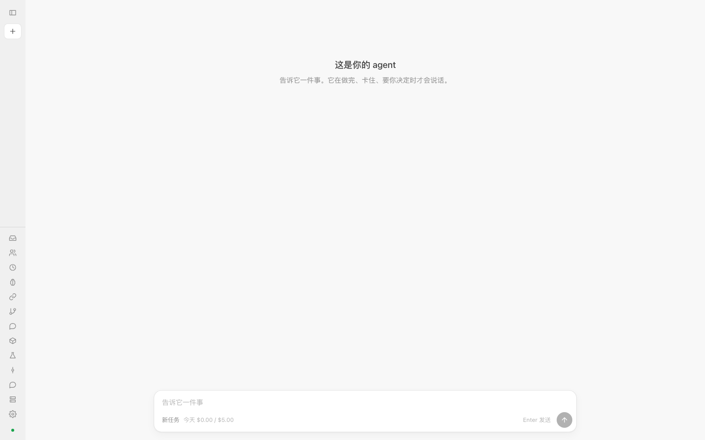

## 13. 部署在哪、怎么连

部署者会告诉你地址。默认:工作台和 HTTP / SDK 在 **18700**(工作台是 `/ui/`),E2B 形状的口在 **18710**;端口只绑 127.0.0.1,对外要放一个反向代理在前面([deploy/README.md](../../deploy/README.md))。

## 14. 常见问题

**429:没有容量,或碰到配额。** 看响应里的 `error`:

- `quota: sandboxes`:本项目沙箱数到上限了(配额的 `max_sandboxes`)。删掉不用的,或让 owner 提高。
- `quota: storage`:本项目的可写层加卷加这次要的盘超过 `max_storage_gib`,响应带 `used_mib`、`asked_mib`。
- 没有节点有空位 / 内存:稍后重试,或把别的沙箱暂停、删掉。`batch` 与 `background` 优先级只放到还留有余量的节点,`interactive` 优先。
- 卷被别人写着:同一个卷不能同时有两个写者(见第 6 节)。
- 你的令牌每分钟请求太多:非 admin 每令牌每分钟有上限,响应带 `Retry-After`,等这么多秒。
- SDK 里 429 都是 `NoCapacity`。

**402:每日预算。** 响应 `quota: daily budget`:项目今天的花费到了配额里的 `daily_usd`。等到明天,或让 owner 调高。SDK 里是 `QuotaExceeded`。另外,沙箱里的模型调用超过**这台沙箱的预算**时,模型代理也回 402(见[预算教程](tutorials/budget-and-ticket.md))。

**沙箱为什么暂停了?** 常见原因:`persistent` 沙箱空闲到了 `ttl_idle_s`,自动暂停;资源紧张时为了让位给 `interactive` 的请求,`background` / `batch` 的沙箱会先被暂停(`persistent` 只暂停不杀,`ephemeral` 的才可能被结束);节点升级时 persistent 沙箱被暂停到盘再恢复。暂停不丢东西,点"恢复"或直接执行命令、访问端口会自动恢复。若设了 `retain_paused_s`,暂停超过这么久会被删掉(0 = 一直留)。`ephemeral` 空闲到期是直接销毁,不是暂停。

**放宽出口为什么返回 202?** 因为你是 member:放宽要 owner 点头。202 的响应里有申请 id,节点没动;owner 批准后才生效,收紧则立即生效。见第 5 节。

**端口为什么浏览器直接打不开?** 端口地址需要 `Authorization: Bearer <令牌>` 头,地址栏的普通导航不带这个头。用 `curl -H "Authorization: Bearer $CAIRN_TOKEN" <地址>`、详情页的"试一下 GET /",或 SDK 的 `sb.ports.get()`;WebSocket 用 `sb.ports.websocket()`。端口没人监听时返回 502,端口号不合法 400。

**令牌丢了 / 失效了(401)?** 让 owner 给你换令牌(第 1 节);有有效期的令牌到期同样要换。

**删不掉卷(409)?** 它还挂在某台沙箱上。先删那台沙箱或等它销毁。

**构建失败?** 构建表"结果"列显示错误。节点连不上镜像仓库时,换 `docker save` 归档上传,见[自定义模板教程](tutorials/custom-template.md)。

## 15. 用邀请码开户

平台发给你一个一次性邀请码(`inv_…`)。打开新控制台登录页,点"有邀请码?创建账户",填邀请码、账户名(小写字母、数字、`_`、`-`,2–32 位)、你的用户名。创建成功会**只显示一次**你的令牌——先存好再点"进入控制台"。你是新账户的 **owner**。邀请码可能带着起步额度(账户自动变成预付)和试用配额(并发沙箱数、日预算),在「项目设置」与「用量与账单」里能看到。名字被占用时邀请码不会作废,换个名字再试。

## 16. API 密钥(给 CI、脚本、看板)

不要把个人令牌放进 CI。owner 在「成员与密钥」页的"API 密钥"一栏创建**命名密钥**:选权限(成员 = 读写、viewer = 只读)、有效天数(0 = 不过期),点"创建密钥",**secret 只显示一次**。密钥只能访问当前这一个项目;viewer 密钥做任何写操作都会得到 403 `read-only credential`;密钥不能再创建密钥,也没有 owner 权限。列表里能看到每把密钥最近一次使用的时间;不用了点"撤销",下一个请求就失效。用法与令牌相同:`Authorization: Bearer cairn_…`,SDK 里 `Client(token="cairn_…")`。

## 17. 预付额度与余额

如果你的账户是**预付**:「用量与账单」页多一块"余额(预付)"。余额 = 累计充值 − 所有项目的累计花费。**降到 0 时**:新建沙箱会得到 402 `quota: out of credit`,账户会被暂停(运行中的沙箱被暂停、状态保留,页面顶部出红色提示),**充值后立刻恢复**(你自己点恢复要恢复的沙箱)。充值联系平台(部署者),他会给你记一笔;owner 可以查余额与最近 20 笔账本:`GET /accounts/<账户>/balance`。

## 18. 在浏览器里打开沙箱里的服务(预览域名)

如果平台开了预览域名(`PREVIEW_DOMAIN`),沙箱里监听在 8080 端口的 web 服务,可以直接在浏览器打开 `https://8080-<沙箱 id>.<预览域名>/?token=<你的令牌>`:第一次访问会把令牌存进一个只对这个站点有效的 HttpOnly cookie 并跳转去掉地址栏里的令牌,之后页面里的子请求自动带上。令牌就是你的成员令牌,**不要把这个链接发给别人**(会泄露令牌);给别人看请让对方登录自己的账户。

## 19. 服务状态

`https://<控制面>/status`(JSON)与 `/console/status/`(页面)不需要登录,显示接口、注册表、数据库、存储、沙箱五个组件的状态。HTTP 503 表示服务中断。排查"是平台的问题还是我的问题"先看这里。

